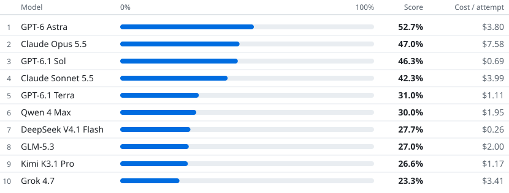
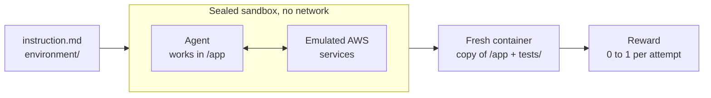

<div align="center">


*Can coding agents fix and build programs that run on AWS?*

[](https://awslabs.github.io/swe-cloud/site/)
[](https://awslabs.github.io/swe-cloud/site/#leaderboard)
[](https://awslabs.github.io/swe-cloud/site/tasks.html)
[](https://github.com/harbor-framework/harbor)
[](LICENSE)

</div>

**SWE-Cloud** tests whether AI coding agents can fix and build cloud software that depends on AWS. In **issue-fixing** tasks the agent resolves a production incident in an AWS-backed service. In **program-construction** tasks it rebuilds a real program from its documentation and a binary it can run but not read. Each task runs in a sandbox with no internet access, against AWS services emulated by [Floci](https://github.com/floci-io/floci).

This repository holds the tasks and `swecloud`, a thin command over [Harbor](https://github.com/harbor-framework/harbor) that pins the evaluation protocol. The [website](https://awslabs.github.io/swe-cloud/site/) has the overview, the task gallery and the full leaderboard.

## Leaderboard

<p align="center"><a href="https://awslabs.github.io/swe-cloud/site/#leaderboard"></a></p>

<details>
<summary>Scores by split and cost per attempt</summary>

| # | Model | SWE-Cloud Score | IF pass@1 | PC pass@1 | Cost / attempt |
| ---: | --- | ---: | ---: | ---: | ---: |
| 1 | GPT-6 Astra | **52.7%** | 78.9% | 13.3% | $3.80 |
| 2 | Claude Opus 5.5 | **47.0%** | 67.8% | 15.8% | $7.58 |
| 3 | GPT-6.1 Sol | **46.3%** | 72.2% | 7.5% | $0.69 |
| 4 | Claude Sonnet 5.5 | **42.3%** | 69.4% | 1.7% | $3.99 |
| 5 | GPT-6.1 Terra | **31.0%** | 49.4% | 3.3% | $1.11 |
| 6 | Qwen 4 Max | **30.0%** | 46.1% | 5.8% | $1.95 |
| 7 | DeepSeek V4.1 Flash | **27.7%** | 46.1% | 0.0% | $0.26 |
| 8 | GLM-5.3 | **27.0%** | 45.0% | 0.0% | $2.00 |
| 9 | Kimi K3.1 Pro | **26.6%** | 44.4% | 0.0% | $1.17 |
| 10 | Grok 4.7 | **23.3%** | 38.9% | 0.0% | $3.41 |

</details>

**SWE-Cloud Score** is pass@1 over all 100 tasks: 60 issue-fixing (IF) and 40 program-construction (PC), 3 attempts each, with the protocol harness. Cost is the estimated API cost per attempt. Full evaluation metrics and protocols are detailed on the [full leaderboard](https://awslabs.github.io/swe-cloud/site/#leaderboard).

## Tasks

Each task is a standard Harbor task folder with its own `README.md` and diagram.

| Split | Tasks | Budget | Folder |
| --- | ---: | --- | --- |
| Issue fixing | 60 | 1 hour | [`tasks/issue-fixing/`](tasks/issue-fixing/) |
| Program construction | 40 | 4 hours | [`tasks/program-construction/`](tasks/program-construction/) |

Browse them in the [task gallery](https://awslabs.github.io/swe-cloud/site/tasks.html). Where each task comes from is listed in [tasks/SOURCES.md](tasks/SOURCES.md).

## Quickstart

> The steps below assume an x86-64 Linux host with Docker and [uv](https://docs.astral.sh/uv/). For another setup, provider or sandbox, let your coding agent follow the [`swe-cloud-run`](.agent/skills/swe-cloud-run) skill.

```bash
git clone https://github.com/awslabs/swe-cloud && cd swe-cloud
uv sync --locked && source .venv/bin/activate
cp .env.example .env    # set OPENROUTER_API_KEY, or a Bedrock key
```

Verify the model route and the sealed sandbox:

```bash
swecloud check --profile openrouter --model deepseek/deepseek-v4.1-flash --effort high --egress
```

### Program construction: fetch the reference programs

The reference programs of the program-construction tasks are stored with [Git LFS](https://git-lfs.com) (about 2.3 GB). Issue fixing does not need them.

```bash
git lfs install && git lfs pull
```

### Amazon Bedrock in place of OpenRouter

Use `--profile bedrock-docker` and pass an inference-profile id (starting with `global.` or `us.`) as `--model`. Authentication is a Bedrock API key in `AWS_BEARER_TOKEN_BEDROCK`, or the standard AWS credential chain.

## Run a split

```bash
swecloud run --profile openrouter --split issue-fixing \
    --model deepseek/deepseek-v4.1-flash --effort high \
    --n-concurrent 4 --job-name my-run
```

This runs each issue-fixing task 3 times under the settings in [`protocol.toml`](protocol.toml). Use `--split program-construction` for the other split. Results are written under `jobs/my-run/`.

### Try it cheaply first

```bash
swecloud run ... --preset oracle   # reference solutions, no LLM: every task should score 1 on your host
swecloud run ... --preset smoke    # two tasks, one attempt each
swecloud run ... --task 'swe-cloud/if-dynamodb-*'   # a subset, by name or glob
```

### Raw harbor command

`swecloud run` builds one `harbor run` command; add `--dry-run` to print it for your choices.

```bash
harbor run --job-name my-run --jobs-dir "$PWD/jobs" --path "$PWD/tasks/issue-fixing" \
    --n-attempts 3 --n-concurrent 4 --max-retries 1 --timeout-multiplier 1.0 \
    --env docker --agent swecloud.agents.terminus:Terminus2 \
    --model openrouter/deepseek/deepseek-v4.1-flash \
    --ak record_terminal_session=false --ak reasoning_effort=high \
    --ak 'llm_kwargs={"timeout":1200,"max_tokens":128000}' --yes
```

## Score

```bash
swecloud score jobs/my-run                    # pass@1, pass@k, almost@1, cost, harness events
swecloud score jobs/my-if-run jobs/my-pc-run  # both splits: adds the SWE-Cloud Score
```

## How an attempt is graded



- **No AWS account.** AWS services are emulated inside the sandbox by Floci 2.2.0, an open-source AWS emulator, and the sandbox has no network access.
- **Separate grading.** Hidden tests never enter the agent's container; they run on a copy of `/app` in a fresh one.
- **Reward.** Issue fixing: 1 when every hidden test passes, otherwise 0. Program construction: the fraction of hidden tests passed; an attempt passes only at 1.
- **Three attempts per task.** pass@1 is the mean pass rate over them. The **SWE-Cloud Score** combines the issue-fixing and program-construction pass@1, each weighted by its share of the tasks.

## Documentation

- [Evaluation protocol](docs/EVALUATION_PROTOCOL.md): settings, scoring, known issues, sandbox isolation
- [Models and profiles](docs/MODELS.md): `--model`, `--reasoning`, adding a provider
- [Compute](docs/COMPUTE.md): per-trial reservations and host sizing
- [Task format](docs/TASKS.md): task folders, `task.toml` fields, release checks

## Citation

If you use SWE-Cloud, please cite:

```bibtex
@misc{swecloud2026,
  title        = {SWE-Cloud: Can coding agents fix and build programs that run on AWS?},
  author       = {Wang, Yawei and Li, Sida and Lu, Bryan and Xiong, Siheng and Tan, Sijun and Xu, Panpan and Huan, Luke},
  year         = {2026},
  url          = {https://github.com/awslabs/swe-cloud},
  note         = {Equal contribution: Yawei Wang, Sida Li}
}
```

## Security and license

Agents run model-generated commands, so use a dedicated VM and credentials limited to model invocation. See [SECURITY.md](SECURITY.md). Apache License 2.0; see [LICENSE](LICENSE) and [NOTICE](NOTICE).
