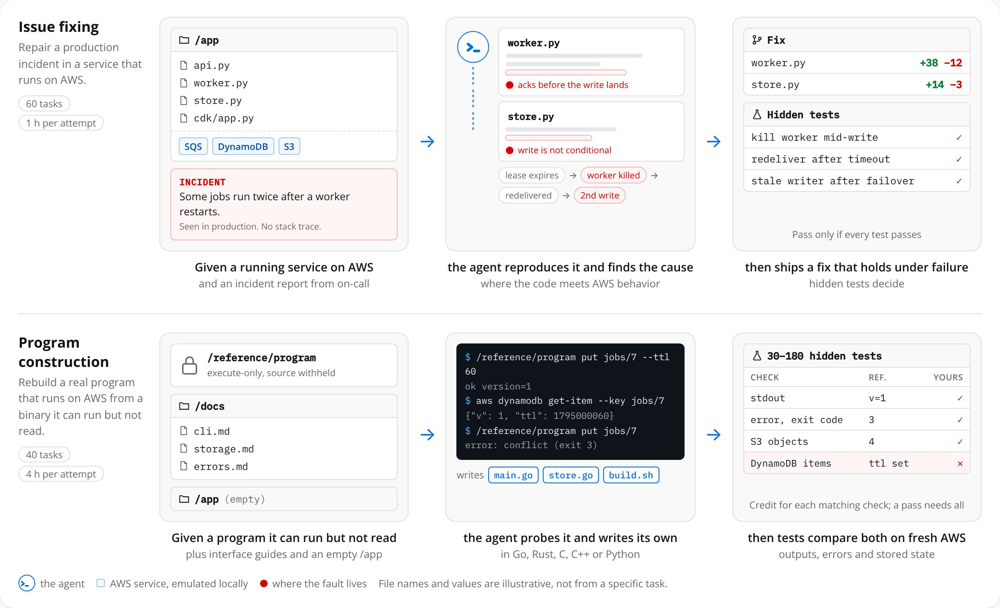
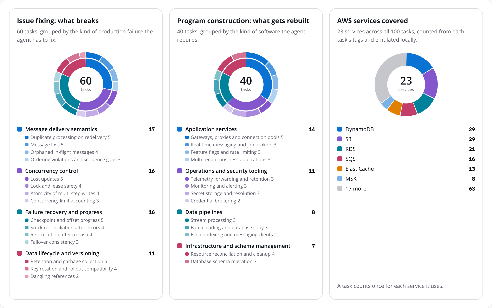

<div align="center">


**Can coding agents fix and build programs that run on AWS?**

[Website](https://awslabs.github.io/swe-cloud/site/) ·
[Task gallery](https://awslabs.github.io/swe-cloud/site/tasks.html) ·
[Leaderboard](https://awslabs.github.io/swe-cloud/site/#leaderboard) ·
[Evaluation protocol](docs/EVALUATION_PROTOCOL.md)

[](LICENSE)
[](https://github.com/harbor-framework/harbor)
[](tasks/SOURCES.md)

</div>

SWE-Cloud is a benchmark of 100 tasks for AI coding agents on software that runs on AWS: workers, queue consumers, schedulers, storage engines and gateways. In 60 tasks the agent fixes a production incident in an AWS-backed service. In 40 it rebuilds a real program from its documentation and a binary it can run but not read. Every task runs in a sealed sandbox with local AWS services, so it **needs no AWS account**, and the task sandboxes have no network access (the host only reaches the model provider and, while images build, package mirrors). Hidden tests replay crashes, retries and failovers, then check what the code left in AWS.

## Leaderboard

| # | Model (effort) | Lab | Weights | Harness | SWE-Cloud Score | Cost / attempt |
| ---: | --- | --- | --- | --- | ---: | ---: |
| 1 | GPT-6 Astra (xhigh) | OpenAI | Closed | Terminus 2 † | 52.7% | $3.80 |
| 2 | Claude Opus 5.5 (xhigh) | Anthropic | Closed | Terminus 2 † | 47.0% | $7.58 |
| 3 | GPT-6.1 Sol (xhigh) | OpenAI | Closed | Terminus 2 † | 46.3% | $0.69 |
| 4 | Claude Sonnet 5.5 (xhigh) | Anthropic | Closed | Terminus 2 † | 42.3% | $3.99 |
| 5 | GPT-6.1 Terra (xhigh) | OpenAI | Closed | Terminus 2 † | 31.0% | $1.11 |
| 6 | Qwen 4 Max (high) | Alibaba | [Open](https://huggingface.co/Qwen) | Terminus 2 † | 30.0% | $1.95 |
| 7 | DeepSeek V4.1 Flash (high) | DeepSeek | [Open](https://huggingface.co/deepseek-ai) | Terminus 2 † | 27.7% | $0.26 |
| 8 | GLM-5.3 (high) | Z.ai | [Open](https://huggingface.co/zai-org) | Terminus 2 † | 27.0% | $2.00 |
| 9 | Kimi K3.1 Pro (high) | Moonshot AI | [Open](https://huggingface.co/moonshotai) | Terminus 2 † | 26.6% | $1.17 |
| 10 | Grok 4.7 (xhigh) | xAI | Closed | Terminus 2 † | 23.3% | $3.41 |

**SWE-Cloud Score** = 0.6 × issue-fixing pass@1 + 0.4 × program-construction pass@1 (with 60 and 40 tasks, pass@1 over all 100 tasks). **pass@1** is the mean success rate over 3 attempts per task; **almost@1** is the share of attempts that pass at least 95% of the hidden tests. **Cost** is the estimated API cost per attempt in USD, at list prices from a pinned LiteLLM price table. Per-split results (pass@1, pass@3, almost@1) are on the [website](https://awslabs.github.io/swe-cloud/site/) and in [`site/data/leaderboard.json`](site/data/leaderboard.json).

† **Terminus 2** is the SWE-Cloud protocol harness: Harbor's Terminus 2 with bug fixes, for example a shell that restarts after a stray `exit` or a large paste, provider content-filter declines and `max_tokens` truncations counted instead of crashing the run, and terminal recording off ([details](docs/EVALUATION_PROTOCOL.md#4-known-issues-and-how-the-protocol-handles-them)).

## How the tasks work

<p align="center"></p>

| | Issue fixing | Program construction |
| --- | --- | --- |
| Tasks | 60, in [`tasks/issue-fixing/`](tasks/issue-fixing/) | 40, in [`tasks/program-construction/`](tasks/program-construction/) |
| Budget per attempt | 1 hour | 4 hours |
| Reward per attempt | 0 or 1: passes when every hidden test passes | fraction of hidden tests passed (30 to 180 per task); passes at 1 |

## What the tasks cover

<p align="center"></p>

## How to run this benchmark

One worked example: the 60 issue-fixing tasks with DeepSeek V4.1 Flash through OpenRouter, in local Docker sandboxes. You need an x86-64 Linux host ([docs/COMPUTE.md](docs/COMPUTE.md)), Docker, [uv](https://docs.astral.sh/uv/) and [Git LFS](https://git-lfs.com).

```bash
# 1. Set up, once per machine
git clone https://github.com/awslabs/swe-cloud && cd swe-cloud
git lfs install && git lfs pull
uv sync --locked && source .venv/bin/activate
cp .env.example .env   # set OPENROUTER_API_KEY

# 2. Check the route and the sealed sandbox, then run every task 3 times
swecloud check --profile openrouter --model deepseek/deepseek-v4.1-flash --effort high --egress
swecloud run --profile openrouter --split issue-fixing --model deepseek/deepseek-v4.1-flash --effort high --n-concurrent 4 --job-name my-run

# 3. Grading is automatic: hidden tests run in a fresh container and write a reward per attempt
#    (0 or 1 for issue fixing, the fraction of tests passed for program construction)

# 4. Score: pass@1 and pass@3
swecloud score jobs/my-run
```

`swecloud run` builds a single `harbor run` command from the [evaluation protocol](protocol.toml); add `--dry-run` to print it for your choices.

**Another model, provider or sandbox?** Use the [`swe-cloud-run`](.agent/skills/swe-cloud-run) skill with your coding agent. It walks through the choices (Amazon Bedrock or OpenRouter, Docker or a hosted sandbox) and says which combinations are tested.

## How the tasks are grounded

- **Issue fixing reproduces real failures.** 51 of the 60 tasks follow a public issue or pull request in an open-source project; the other 9 follow a published design, an engineering article, an incident postmortem or a paper.
- **Program construction rebuilds real programs.** Each of the 40 tasks reconstructs an open-source program at a fixed revision; the reference the agent runs is a build of that revision.

The task's own files don't name the project, but every source is listed publicly in [tasks/SOURCES.md](tasks/SOURCES.md), and upstream projects and licenses are in each task's `ATTRIBUTION.md`. A model may have seen the original fix or program, so read scores with possible training exposure in mind.

## Documentation

| | |
| --- | --- |
| [Evaluation protocol](docs/EVALUATION_PROTOCOL.md) | settings, scoring, known issues, sandbox isolation |
| [Models and profiles](docs/MODELS.md) | `--model`, `--reasoning`, adding a provider |
| [Compute](docs/COMPUTE.md) | per-trial reservations and host sizing |
| [Task format](docs/TASKS.md) | task folders, `task.toml` fields, release checks |
| [Website source](site/) | the front page and its data files |

## Security and license

Agents run model-generated commands: use a dedicated VM, a low-privilege user and credentials limited to model invocation ([sandbox isolation](docs/EVALUATION_PROTOCOL.md#7-sandbox-isolation)). Report vulnerabilities as described in [SECURITY.md](SECURITY.md).

Apache License 2.0; see [LICENSE](LICENSE) and [NOTICE](NOTICE). Contributions are welcome; see [CONTRIBUTING.md](CONTRIBUTING.md).
