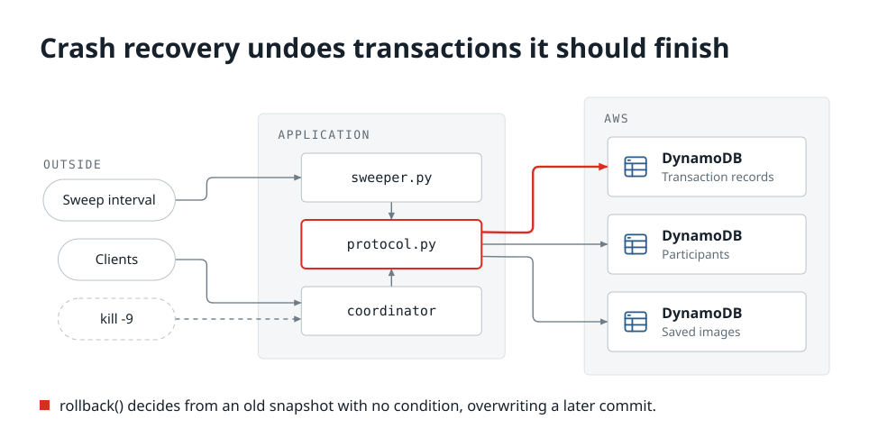

# Crash recovery undoes transactions it should finish

A DynamoDB transaction service's sweeper rolls back settled commits, reverts acknowledged writes, stalls on half-done records and strands locks.

## The system
`/app` offers multi-item transactions using only single-item conditional writes on DynamoDB. A coordinator process records the whole intent in the `tx` table, locks each row in `items`, copies its old value to `images`, applies the write, then decides COMMITTED or ROLLED_BACK and cleans up. A separate sweeper process finishes what dead coordinators left.

## What goes wrong
A host running several coordinators died from SIGKILL. By morning:
- A transaction verified as COMMITTED read `ROLLED_BACK`, with its values back at baseline.
- A write acknowledged after the crash showed its old value by the next pass.
- One abandoned record never completed, with a saved image still around.
- One participant refuses every write. Its lock names a record already reaped.

## Where the issue is
Mostly `protocol.py`. `rollback()` writes `ROLLED_BACK` with an unconditional `UpdateItem`, relying on a snapshot the sweeper read earlier, so it overwrites a commit that landed in between. `restore_item()` replaces the item with an unconditional `PutItem`, so a late restore erases a newer acknowledged write. It also raises when an image is missing, which happens for requests never applied or already restored, so cleanup never finishes.

`sweeper.py` only looks at existing records. A parked writer that wakes after its record was reaped leaves a lock or image nothing reclaims.

## What a correct fix must do
- Never flip a durable decision or undo its writes; finish the record the way it decided.
- Keep acknowledged writes visible after any later pass.
- Complete abandoned records within 15 seconds, at the 2000 ms age threshold. Raising thresholds or declining to intervene does not count.
- Let a later pass finish whatever a killed process left.
- Leave no stuck lock or unexplained image, even after the record is gone.
- Keep single-item access. Multi-item transactional and batch APIs are refused.

## How it is graded
The tests run real coordinator and sweeper processes on fresh tables, with 101 participants in the main schedule. The program announces pauses over a socket, and the tests hold a process at a chosen pause, let others overtake it, then release or SIGKILL it. Schedules include a stale sweeper resuming after a commit, a restore resuming after a newer committed write, a commit arriving after rollback, a commit racing an append, and writers waking after their record was reaped. The tests then read DynamoDB directly.

## Why it is hard
The fixes pull against each other. Fencing the decision alone leaves restores unsafe, and refusing to intervene strands locks. Tolerating missing images means telling "never saved" from "already restored" using the item alone. Trusting the record table misses what parked writers do after it forgets them.

## Real-world basis
Modelled on the published design document of an open-source client-side transaction library for DynamoDB, rather than on a bug report.

## Task facts

| | |
|---|---|
| Task | `swe-cloud/if-dynamodb-abandoned-transaction-recovery` |
| Type | Issue fixing |
| AWS services | DynamoDB |
| Language | Python |
| Runtime | Local AWS-compatible emulator. No internet access. |
| Hidden tests | 6 test functions |
| Expert estimate | 4 hours |
| Agent time limit | 1 hour |
| Resources | 2 CPUs, 3 GB memory |
