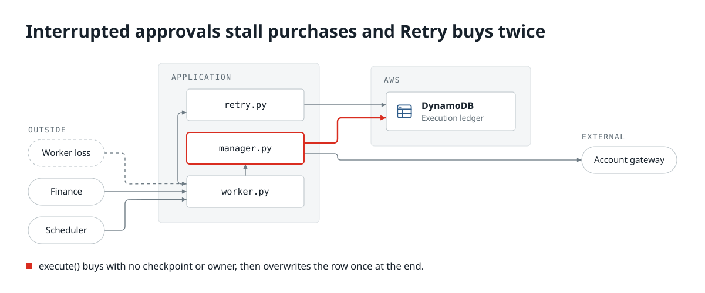

# Interrupted approvals stall purchases and Retry buys twice

A DynamoDB-backed purchasing service abandons or wrongly fails interrupted cloud commitment orders, and clicking Retry can buy recommendations that already succeeded.

## The system
Finance approves orders of commitment recommendations. `worker.py` is the entry point for `approve`, `retry` and `sweep`. Each order is one row in the DynamoDB `executions` table, moving from `pending` to `approved` to a terminal status. `manager.py` buys each recommendation through an account gateway, a separate HTTP service that cannot cancel commitments. Workers can die anywhere, and DynamoDB is all they share.

## What goes wrong
- Some orders sit in progress indefinitely.
- Others become failures needing an operator, even though the gateway could have resolved them.
- Restarting the scheduler does not help.
- Clicking Retry after a mixed outcome can buy successful entries again.

## Where the issue is
In `manager.py`, `execute()` calls the gateway with no record of its intent, then writes the whole row once at the end with a plain `PutItem`, holding no owner or lease. A killed worker leaves no trace of what it dispatched. `sweep()` only stamps an old `approved` row `failed`, never checking the gateway's tagged commitments. In `retry.py`, every call creates a new child row, strips the references, and gives the child a new purchase token, so an approved child buys again.

The right shape uses conditional writes for ownership, a checkpoint before and after each purchase, and one original identity for each recommendation.

## What a correct fix must do
- Settle abandoned work and finish recoverable entries with their real references.
- Never buy a recommendation twice. An ambiguous purchase with no token or tag ends with a useful error, not a guess.
- Leave young approvals and unexpired maintenance owners alone, and let later sweeps finish after a sweep dies.
- Return one child for repeated or concurrent Retry calls, recorded atomically, keeping references and purchase identity through every generation.

## How it is graded
The tests run a private account gateway that can commit then withhold its reply, hold before committing, or delay a commit, per offering. Worker processes are SIGKILLed at the deadline, and snapshots of rows and purchases are taken across about two minutes of sweeps, some concurrent. One stale sweep is paused while a rival finishes, then released. Retry loses a reply while two more requests are in flight, and a 21 second wait outlasts the token's deduplication window before approval. Checks require one commitment per selected entry and intact parent history.

## Why it is hard
A lost reply says nothing about the purchase. In this task's gateway, a request can still commit for 15 seconds and a token only deduplicates for 20, so token recovery sometimes has to defer to a later sweep. Other products cannot be repeated safely at all. Ownership, checkpoints and retry identity must all survive a kill at any instruction.

## Real-world basis
Modelled on a failure publicly reported against an open-source commitment purchasing tool.

## Task facts

| | |
|---|---|
| Task | `swe-cloud/if-dynamodb-interrupted-approval-double-purchase` |
| Type | Issue fixing |
| AWS services | DynamoDB |
| Language | Python |
| Runtime | Local AWS-compatible emulator. No internet access. |
| Hidden tests | 11 test functions |
| Expert estimate | 4 hours |
| Agent time limit | 1 hour |
| Resources | 2 CPUs, 3 GB memory |
