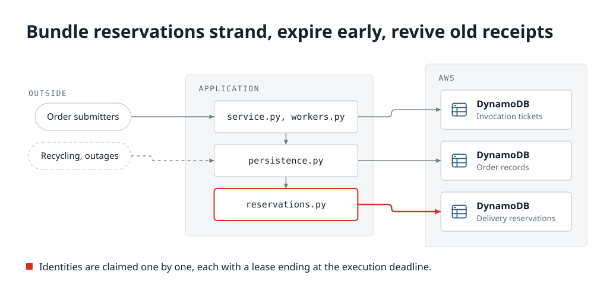

# Bundle reservations strand, expire early and revive old receipts

An order dispatch service reserves shared deliveries in DynamoDB one at a time, so refused bundles leave claims behind and finished bundles lose their protection too soon.

## The system
A scheduler runs each accepted order as a durable execution across many short-lived worker processes. Before each invocation it writes a fresh ticket to `durable_executions`, which revokes the previous worker. A decorator in `idempotency.py` admits the invocation, runs the handler, and stores the receipt in the `idempotency` table. Orders can carry `dispatch_keys`, up to 512 shared delivery identities, reserved in `dispatch_reservations`.

## What goes wrong
- Some accepted orders never produce a receipt after a restart.
- Some orders are dispatched by two executions while the original was still waiting.
- Different order payloads overlap on the same deliveries.
- Reservations stay behind after an admission was refused.

## Where the issue is
The trouble is how `reservations.py` and `persistence.py` link orders to identities. `claim` writes one transaction per identity, each with its own lease set to the execution deadline, and nothing ties those rows to the order row's lifetime. If identity 257 is busy, the 256 already claimed stay held until the deadline. A completed bundle's rows go free at that same deadline, though its receipt lasts far longer. And `complete` checks only its ticket and its own order row, so a delayed worker can publish a receipt after another order took its deliveries.

The right shape gives each reservation a generation on the order row. Identity rows point at it, are claimed in batches under the 100-action `TransactWriteItems` limit, and are taken only after a conditional write retires the previous owner.

## What a correct fix must do
- Enter the handler only with the whole bundle reserved, and return `AlreadyInProgress` on overlap.
- Free a refused admission's identities within three seconds, and an abandoned one's within three seconds of its deadline.
- Protect a completed bundle until its receipt expires.
- Let a killed or replaced execution continue on partial claims while redelivery stays out.
- Stop late completions and cleanups from changing a newer reservation. File locks do not count.

## How it is graded
Tests start workers in fresh processes, reaching DynamoDB through relays that hold a write, apply it and lose the response, or fail it. They kill owners, rotate tickets mid-flight, overlap bundles of up to 259 identities, shorten response retention, and let a held completion arrive after reclaim. They then inspect order rows, the effects table and callback counts.

## Why it is hard
A bundle cannot fit in one transaction, so admission is partial for a while. Claims must survive for a retrying owner yet vanish in one step on refusal. A lost response proves nothing, and an acknowledgement recovered after the deadline must not admit a callback.

## Real-world basis
Modelled on a change publicly proposed to an open-source serverless toolkit's idempotency feature, concerning in-progress ownership across durable replays.

## Task facts

| | |
|---|---|
| Task | `swe-cloud/if-dynamodb-order-dispatch-durable-replay-duplicates` |
| Type | Issue fixing |
| AWS services | DynamoDB |
| Language | Python |
| Runtime | Local AWS-compatible emulator. No internet access. |
| Hidden tests | 25 test functions |
| Expert estimate | 4 hours |
| Agent time limit | 1 hour |
| Resources | 2 CPUs, 3 GB memory |
