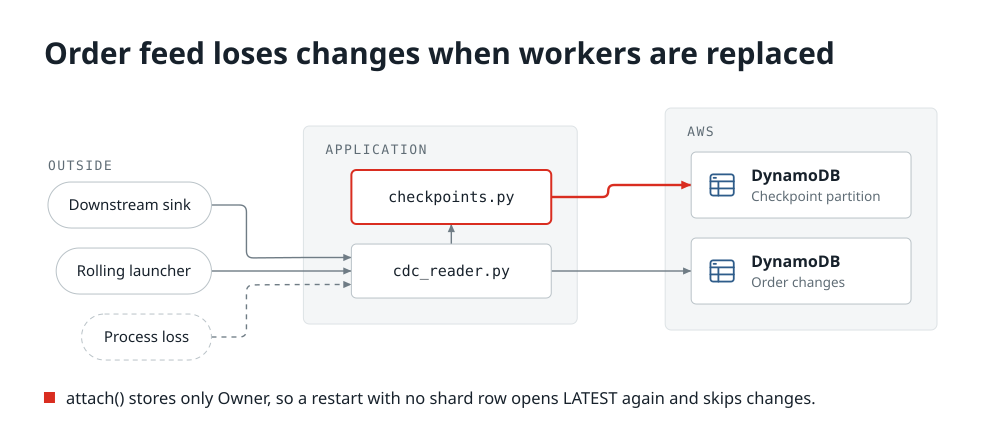

# Order feed loses changes when workers are replaced

A DynamoDB Streams order feed keeps no durable start point and fences workers with a read before an unconditional write, so a rolling replacement can silently skip changes.

## The system
`cdc_reader.py` reads DynamoDB Streams for the `orders` table and prints each change as a `DELIVER` line. A downstream sink answers `ACK <seq>` on stdin, and `progress.py` batches the highest contiguous acknowledged sequence into a separate checkpoint table, keyed by stream ARN and shard. That partition is the only durable subscription state. A rolling launcher starts each successor without waiting for the last to drain.

## What goes wrong
- The order feed occasionally has holes after a worker is replaced.
- Downstream has no committed output for some missing changes.
- Normal shutdowns do not reproduce it.

## Where the issue is
Nothing durable records where a `latest` subscription began. `attach()` in `checkpoints.py` stores only an `Owner`, and `cdc_reader.py` decides "fresh start" by looking for shard rows. A worker killed after `READY` but before its first checkpoint leaves none, so its replacement asks for a new `LATEST` iterator and skips everything outstanding or written during downtime.

Ownership has the same gap. `attach()` overwrites `Owner` unconditionally, and `save()` reads `Owner`, then sends a plain `PutItem`. A superseded worker's in-flight request can land after takeover and move the recovery position past changes the successor still owes.

The right shape keeps a start boundary in the checkpoint partition before `READY`, compares owners when acquiring, and ties each checkpoint to the owner row in one transaction.

## What a correct fix must do
- Keep backlog from before first start excluded across replacements.
- Deliver outstanding and downtime changes again after a crash. Duplicates are fine, gaps are not.
- Commit nothing from a superseded worker, including writes already sent.
- Keep batching, gap-holding, SIGTERM flush and old shard rows working.
- Saving a `LATEST` iterator does not count: it is an opaque handle, not a position.

## How it is graded
Each test creates its tables and runs real worker processes against a local AWS-compatible emulator. It kills workers before their first checkpoint and writes during downtime. A control socket holds a launch mid-startup to force overlaps, and an HTTP relay keeps a predecessor's checkpoint write in flight until its successor has taken over. Other cases plant an old-format shard row or share the table with a second stream. The tests read checkpoint rows at each stage, check deliveries, and confirm the source is untouched.

## Why it is hard
A LATEST iterator gives nothing to persist, so the boundary needs its own record and a conservative timestamp filter. Fencing with a prior read is too late, so check and write must be one atomic request. A predecessor's legitimate commit during startup must still count, so a successor re-reads after acquiring.

## Real-world basis
Modelled on a failure addressed by a public pull request to an open-source stream connector's DynamoDB change-capture input.

## Task facts

| | |
|---|---|
| Task | `swe-cloud/if-dynamodb-order-feed-gaps-after-failover` |
| Type | Issue fixing |
| AWS services | DynamoDB |
| Language | Python |
| Runtime | Local AWS-compatible emulator. No internet access. |
| Hidden tests | 6 test functions |
| Expert estimate | 4 hours |
| Agent time limit | 1 hour |
| Resources | 2 CPUs, 3 GB memory |
