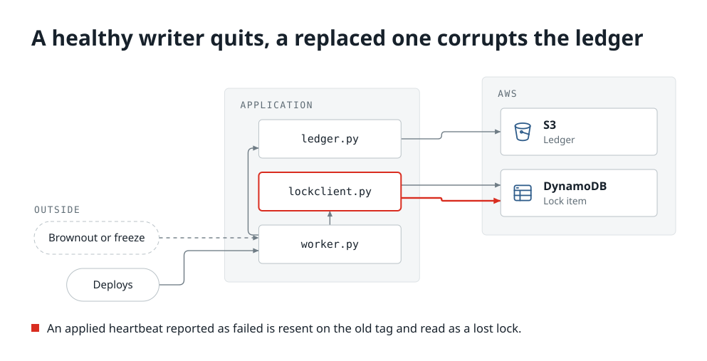

# A healthy writer quits, a replaced one corrupts the ledger

A DynamoDB lease lock picks one writer for an S3 ledger. A heartbeat applied but reported failed makes the holder quit, and a replaced holder can still land writes behind its successor.

## The system
`fenced_worker` runs as separate processes. One holds a lease lock, a single item in the DynamoDB table `locks`, and appends an entry to `ledger.json` in a versioned S3 bucket. The holder rotates `recordVersionNumber` with a conditional `UpdateItem` each second. A standby takes over with a conditional `PutItem` if that tag stops changing for lease plus buffer. Each acquisition raises `fence`, and a reconciliation job audits every ledger version for lost entries and epoch order.

## What goes wrong
- During a DynamoDB brownout, `worker-1` logs a failed heartbeat, then `ConditionalCheckFailedException`, and stops appending. Then `worker-2` takes over.
- The lock-table stream shows the "failed" heartbeat was applied. Nobody else touched it.
- After real failovers, an acknowledged `worker-2` entry is missing from the ledger, and fence 1 entries follow fence 2 entries.

## Where the issue is
In `lockclient.py`, a failed heartbeat is resent conditioned on the old tag. If the first attempt landed, the condition fails, and the client reads that as losing the lock, though the stored tag is its own.

In `ledger.py`, `append` reads the object and then does a plain `PutObject`, with no `If-Match` and no look at the ledger's fence. A write sent before a stall lands later and replaces the successor's version. `release` also deletes the lock item on SIGTERM, so the next acquirer restarts at fence 1, which defeats any fence check.

The right shape settles every doubtful heartbeat against the stored item, and makes the ledger write conditional on the version just read.

## What a correct fix must do
- Keep the lock when the stored tag is any tag this holder tried, and keep appending.
- Never get a replaced holder's write behind a successor.
- Keep the fence growing across releases, and hand over within 5 seconds of SIGTERM.
- Recognise an acquiring write that was applied but reported failed.
- Keep the item and ledger layouts unchanged.

## How it is graded
Two real worker processes run behind per-worker fault proxies. The proxies drop heartbeat responses after the write commits, blackhole DynamoDB, and hold a `PutObject` until the successor has appended. One case freezes the holder with SIGSTOP mid-append. Another keeps lock reads dark for 3.5 seconds after an applied heartbeat, and a rolling SIGTERM restart also drops the standby's acquiring response. The tests audit the lock stream, every S3 version, both journals and takeover timing.

## Why it is hard
One field serves both obligations. Trusting the stored item keeps a healthy holder, but only fencing stops a stale one, and fencing only works if the fence survives the release that deploys rely on.

## Real-world basis
Modelled on a failure publicly reported against an open-source DynamoDB lease-lock client.

## Task facts

| | |
|---|---|
| Task | `swe-cloud/if-dynamodb-s3-lock-lost-on-ambiguous-heartbeat` |
| Type | Issue fixing |
| AWS services | DynamoDB, S3 |
| Language | Python |
| Runtime | Local AWS-compatible emulator. No internet access. |
| Hidden tests | 2 test functions |
| Expert estimate | 6 hours |
| Agent time limit | 1 hour |
| Resources | 2 CPUs, 3 GB memory |
