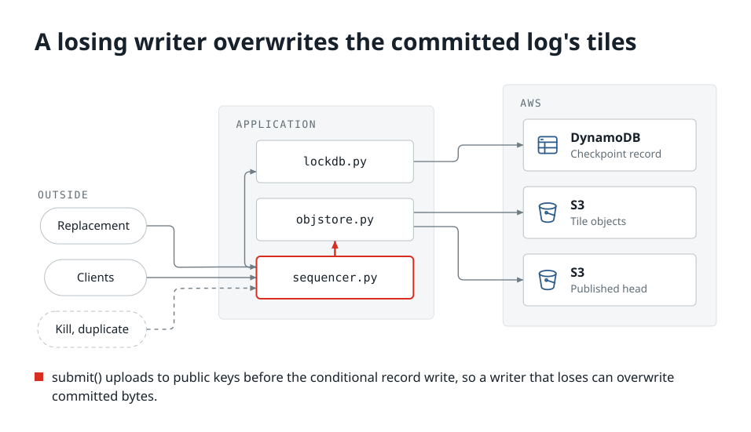

# A losing writer overwrites the committed log's tiles

A Merkle log commits in DynamoDB and publishes in S3. Failover with a duplicate writer leaves tiles disagreeing with the committed root, or a published head stuck behind.

## The system
`sequencer.py` takes `POST /submit` batches and appends them to a Merkle tree. Each log has one item in the DynamoDB `checkpoints` table, the authority on what is committed, advanced by a conditional write. S3 holds what readers use: tile objects at fixed public keys such as `tile/data/<x>.p/<w>`, and a `checkpoint` object as the published head. Workers share nothing except these two services.

## What goes wrong
A failover drill killed the primary mid-commit with a duplicate instance running.
- The root recomputed from published tiles differed from the root in the record. The record itself never moved.
- In another run, a healthy replacement left `checkpoint` describing the empty tree until a later submission.
- In a third, a primary killed before its record write left objects where the replacement had to put different entries.

## Where the issue is
`submit()` in `sequencer.py` uploads tiles to the public keys first and only then attempts the conditional `PutItem`. S3 puts here are last write wins, so a writer that loses the record can still have the last word on the bytes. `load()` only logs when the published head lags, republishes nothing, and refuses to start when tiles mismatch the root. A worker that lost also keeps its old parent in memory.

The right shape keeps candidate bytes under a private key in the bucket, and lets the record decide which reach public keys.

## What a correct fix must do
- Keep public objects matching the tree the record names.
- Let a cold replacement restore the committed tree and head from the services alone.
- Never let an older attempt move the record, change published bytes, or report committed.
- Never let a late writer drag the head backwards.
- Ignore leftovers of an attempt that never reached the record.
- Use no leases or queues, and keep entry bytes out of DynamoDB.

## How it is graded
Three drills run real worker processes against a test relay that can park a record write, forward it while withholding the response, or never forward it. Workers are also held at announced pauses and killed. Drills cover a winner whose reply arrives after the log has grown, a parked rival's original request bytes released late, and a writer killed before its write is forwarded. Batches have several entries, so commits cross tile boundaries. The tests recompute the tree themselves from S3 and DynamoDB.

## Why it is hard
Reordering alone fails: publishing after the record means a crash can lose the only copy, and the table may not hold the bytes. So candidates must be durable before commit yet invisible until selected.

## Real-world basis
Modelled on the checkpoint fencing design of an open-source transparency log server, rather than a bug report.

## Task facts

| | |
|---|---|
| Task | `swe-cloud/if-dynamodb-s3-tile-log-sequencer-failover` |
| Type | Issue fixing |
| AWS services | S3, DynamoDB |
| Language | Python |
| Runtime | Local AWS-compatible emulator. No internet access. |
| Hidden tests | 4 test functions |
| Expert estimate | 4 hours |
| Agent time limit | 1 hour |
| Resources | 2 CPUs, 3 GB memory |
