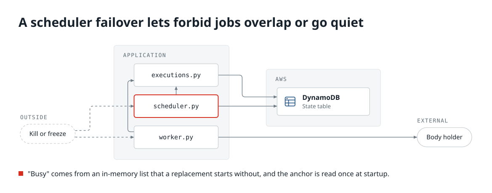

# A scheduler failover lets forbid jobs overlap or go quiet

A two-scheduler job system on DynamoDB forgets running work on failover: jobs run twice, schedules stop, and frozen workers carry on after losing their claim.

## The system
Two scheduler processes contend for a lease in one DynamoDB table. The owner decides each job's scheduled runs, called nominals, and three workers run the bodies. Jobs are `forbid`: one attempt at a time. That table holds the `LEADER` lease, each job's `ACTIVE` running record, one `SLOT#` decision per nominal, and the `ARM` schedule anchor.

## What goes wrong
- After the leading scheduler was replaced, a job started a second attempt while the first still ran.
- On another cluster, a survivor logged a clean takeover, then decided nothing until restarted by hand.
- A frozen worker woke, found permission waiting, and ran a body while a newer attempt held the job.

## Where the issue is
`scheduler.py` decides "busy" from `view.py`, an in-memory list of attempts this process dispatched. A replacement starts with an empty list, so it admits a nominal while `ACTIVE` still names a running attempt, and `claim` in `executions.py` overwrites that record unconditionally. The scheduler also loads jobs and the anchor once at startup, so a survivor started before arming has no periodic nominals. `complete` deletes `ACTIVE` without checking whose it is, and `worker.py` runs the body after permission arrives without rechecking its claim.

The correct shape makes the DynamoDB record the authority, using leases and conditional writes against its `run_id` and `claim_token`.

## What a correct fix must do
- Block a job while a valid `ACTIVE` lease exists, whichever scheduler dispatched it.
- Release a claim whose lease lapsed, so the job runs on a live worker with no table edits.
- Decide every armed nominal after takeover, with one terminal decision each and no replays.
- Ignore completions from superseded attempts.
- Refuse to start a body when the claim was lost during a freeze, even if permission arrived.
- Keep interfaces and item layout. Local files and process memory do not count.

## How it is graded
The tests start two schedulers and three workers and drive one 36 second failover window. They hold one job's body for 22 seconds, SIGKILL the leader, restart that scheduler with empty memory, and replay a completion with stale credentials. Meanwhile the other job's worker is frozen with SIGSTOP, its slot must run elsewhere, and it gets SIGCONT with permission already waiting. Every callback is recorded with a consistent read of `ACTIVE`, then overlapping bodies and the decision ledger are checked.

## Why it is hard
One claim governs both sides of the failover. Treat it as absent and a surviving body overlaps. Treat it as permanent and a dead worker strands its job. A heartbeat's last success says nothing about now, so a thawed worker must confirm before acting.

## Real-world basis
Modelled on a failure publicly reported against an open-source distributed job scheduler.

## Task facts

| | |
|---|---|
| Task | `swe-cloud/if-dynamodb-scheduler-failover-overlapping-jobs` |
| Type | Issue fixing |
| AWS services | DynamoDB |
| Language | Python |
| Runtime | Local AWS-compatible emulator. No internet access. |
| Hidden tests | 10 test functions |
| Expert estimate | 4 hours |
| Agent time limit | 1 hour |
| Resources | 2 CPUs, 3 GB memory |
