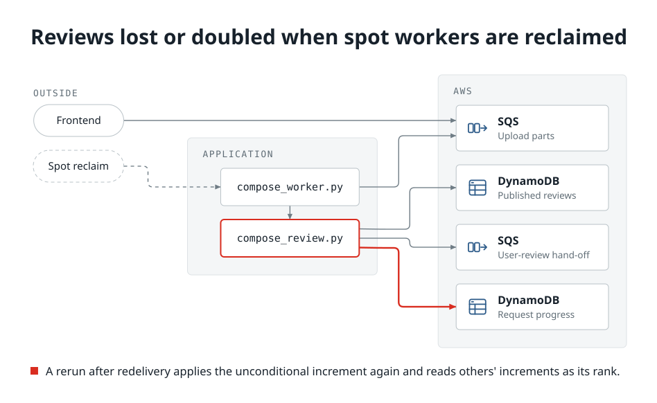

# Reviews lost or doubled when spot workers are reclaimed

Workers assemble five-part reviews from SQS and a DynamoDB counter. A reclaimed worker's redelivered message bumps the counter again, so reviews vanish, double up or miss their hand-off.

## The system
The frontend creates a `review_compose` item for each movie review and queues five part messages on the `upload-parts` SQS queue for workers on spot capacity. Each upload stores its part, increments `counter` and writes a reply to `responses`. The upload that reaches 5 composes the review: it writes `reviews_store`, appends to `movie_reviews`, deletes its `review_compose` item and messages another team's user-review queue. Moderators remove ids from `movie_reviews`, and they must stay removed.

## What goes wrong
- A review never reaches its movie page, or has a field missing.
- The same review is listed twice.
- A listed review misses the author's history.
- `review_compose` items reappear for finished requests, with one part and `counter` 1.
- Replies don't add up: a `rank` of 6, or two parts saying `composed: true`.

## Where the issue is
`upload()` in `compose_review.py` runs an unconditional `ADD counter`, then reads the counter back as its rank. SQS redelivers after the 6 second visibility timeout and the handler reruns from the top, so an increment applied before a kill is applied again, and the read picks up other parts' increments. `compose()` is a chain of separate calls, and its cleanup deletes the item before the hand-off is sent, so a kill between them loses the only record that one is owed. `idempotency.py` only wraps this: a crashed attempt's record expires after 4 seconds and the handler reruns, and a hibernated worker can wake and still write.

The right shape commits part, increment, rank and reply in one conditional transaction, and removes the item after the hand-off.

## What a correct fix must do
- Give ranks 1 to 5 once each, one `composed: true`, and the same reply on repeats.
- Store and list a review once, even when the frontend resubmits it under a new request id.
- Never relist a review that moderation took down, including from a resumed worker.
- Always finish the hand-off and cleanup.
- Handle state the old workers left, without queue changes.

## How it is graded
A relay kills or freezes a worker right after a committed write, before it sees the reply. Scenarios include kills mid-compose, resubmission, frozen workers resuming after a takedown, rollout onto an old pool's half-finished requests, and random kills under load. The tests then inspect replies, stored reviews, listings and hand-offs.

## Why it is hard
No transaction can include the SQS send, so the item must outlive it. A missing page entry proves nothing, since moderation removes entries. Old-code state lacks new markers, and a completing upload reclaimed after cleanup still owes a hand-off and reply.

## Real-world basis
Based on a systems research paper about retried non-idempotent serverless functions, not a bug report.

## Task facts

| | |
|---|---|
| Task | `swe-cloud/if-dynamodb-sqs-review-worker-duplicates-on-redelivery` |
| Type | Issue fixing |
| AWS services | SQS, DynamoDB |
| Language | Python |
| Runtime | Local AWS-compatible emulator. No internet access. |
| Hidden tests | 10 test functions |
| Expert estimate | 3 hours |
| Agent time limit | 1 hour |
| Resources | 2 CPUs, 3 GB memory |
