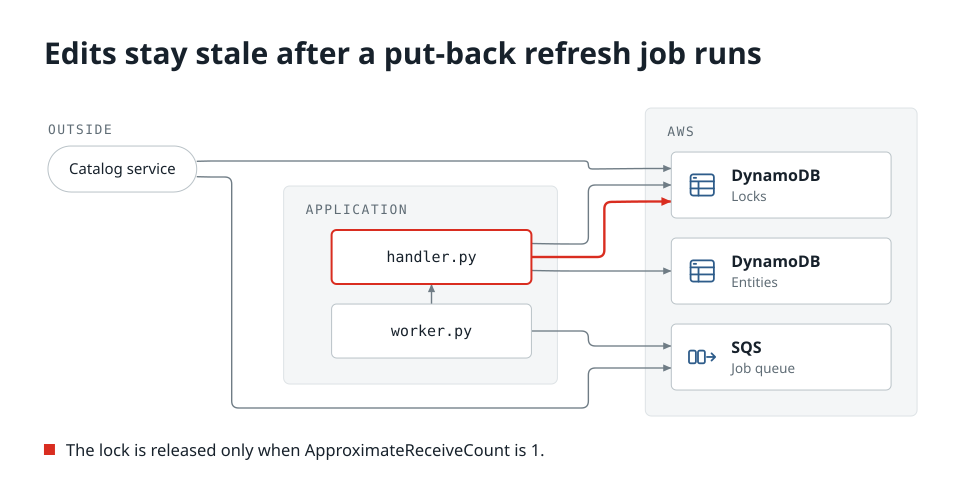

# Edits stay stale after a put-back refresh job runs

A catalog refresher gives up its dedup lock only on an SQS message's first delivery, so a job put back by the overlap guard runs with the lock held and later edits get dropped.

## The system
When the catalog service edits an entity it bumps `dirty_seq` in the `catalog_entities` DynamoDB table and runs `refresher dispatch`. Dispatch takes a dedup lock in `refresh_unique_locks` and queues one job on the `refresh-jobs` SQS queue only if it got the lock. Workers release that lock as a refresh starts, so a later edit can queue another. A second lock table, `refresh_overlap_locks`, stops two refreshes of one entity overlapping. A worker that finds one running puts the message back with `ChangeMessageVisibility`.

## What goes wrong
- `processed_seq` stays behind `dirty_seq` and the search document shows old data until a later edit.
- The queue is empty and no job failed.
- Worker logs look normal: the last refresh succeeded, but ran before the last edit.

## Where the issue is
`refresher/handler.py` releases the dedup lock only when `ApproximateReceiveCount` is 1. Release 2.4.0 added that check to stop retries deleting a newer dispatch's lock. But a put-back job starts on a later delivery, so it keeps its lock while it runs. Dispatches during that refresh are dropped, and no refresh covers those edits.

Delivery count cannot separate a put-back from a retry. Dropping the check brings the old pileup back, because `unique.py` deletes the lock whoever holds it. The correct shape has each job recognise the lock its own dispatch took, then delete it conditionally on that owner.

## What a correct fix must do
- Cover every edit with a refresh that starts after it.
- Release the lock when a put-back job finally starts.
- Leave a newer dispatch's lock alone during a retry, or when a stale copy's lock lapsed and was retaken.
- Change workers only: the dispatcher's messages and lock items stay as they are, and messages carry no owner.
- Handle jobs the old workers already ran or put back.

## How it is graded
Each test gets its own queue, tables and entity on a local AWS-compatible emulator, with real worker processes and the unchanged production dispatcher. A stand-in refresh command logs every start and can wait or fail. Tests hold a refresh open while dispatching, then assert which dispatches are accepted or dropped and which messages start, in what order. Cases cover put-backs, retries, locks that lapse and are retaken, a lock lapsing before first delivery, and a cutover from old workers mid-retry.

## Why it is hard
The message has no owner token and the dispatcher cannot change, so ownership must be inferred from what already exists: the message's dispatch time and the lock's expiry. The obvious change for one failure restores the other.

## Real-world basis
Modelled on a failure publicly reported against an open-source web framework's unique queued jobs.

## Task facts

| | |
|---|---|
| Task | `swe-cloud/if-dynamodb-sqs-unique-job-loses-edits` |
| Type | Issue fixing |
| AWS services | DynamoDB, SQS |
| Language | Python |
| Runtime | Local AWS-compatible emulator. No internet access. |
| Hidden tests | 6 test functions |
| Expert estimate | 3 hours |
| Agent time limit | 1 hour |
| Resources | 2 CPUs, 3 GB memory |
