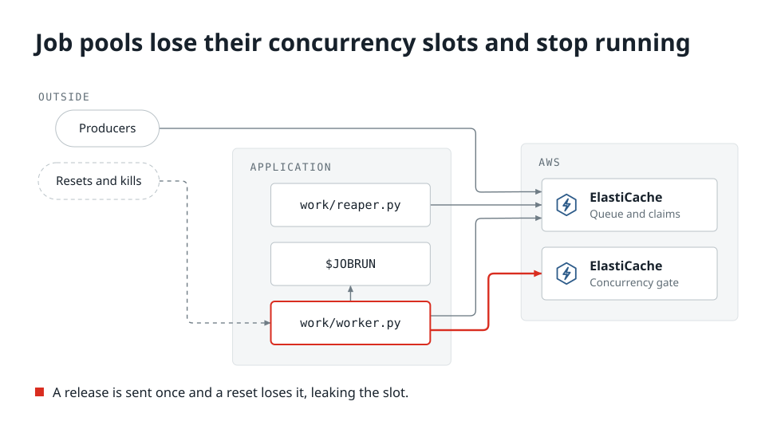

# Job pools lose their concurrency slots and stop running

Worker pools share a concurrency counter in ElastiCache. Connection resets and kills leave every slot taken with nothing running, strand jobs, and run some twice.

## The system
Each pod runs a Python worker pool, `bin/pool`. A job holds a session with an external provider for as long as its runner process lives, and the provider allows three, so the key `work:jobs:process:lock` gates admission. A Lua script atomically claims a job: it increments `lock` and `lock_info`, and moves the job to the pool's in-progress list. Each pool's reaper requeues jobs of pools whose heartbeat stops. Connections go through a node relay.

## What goes wrong
- Pools heartbeat, `lock` reads 3, and at most one job runs. The queue grows until someone deletes keys.
- Logs show bursts of `Connection reset by peer` from `worker.remove_job_from_in_progress.lrem`.
- A few jobs left the queue and never ran.
- A monthly report ran twice: on the pod whose pool process the memory guard killed, and again elsewhere.

## Where the issue is
`remove_job_from_in_progress()` in `work/worker.py` sends its transaction once, logs the error and moves on. A reset before ElastiCache reads the command leaks the unit for as long as the pool lives. When a claim's reply is lost, the worker loop just logs and tries again, so that job stays in-progress with no worker. `work/reaper.py` assumes a stale heartbeat means the runners are gone too, but the memory guard kills only the pool process.

The right shape ties each decrement to that call's own `LREM`, and adds a holder per job that outlives the pool process and keeps a lease while its runner lives.

## What a correct fix must do
- Return unused capacity within 10 seconds, with nobody touching keys.
- Never exceed three executing jobs, even briefly. Blindly retrying the release, or resetting the counter, breaks this.
- Run every job, once. Only jobs whose runner died in a deploy run again.
- Never kill a runner to recover its slot.

## How it is graded
One timeline runs four real pools on one cluster, each behind a test proxy that resets connections at chosen commands, before or after they execute, including the reply to a claim. One pod is SIGKILLed whole, and another loses only its pool process while a 20 second runner continues. A 40 second job runs throughout. The tests' own runner reports what is executing. They check the limit, the counter against running jobs, how long capacity stays unusable, runs per job, and the settled keys.

## Why it is hard
A reset looks the same whether or not the command ran, yet one case needs a retry and the other must not count twice. A dead pool's slot must come back fast, unless its runner lives, so something other than the pool process has to hold the claim.

## Real-world basis
Modelled on a failure publicly reported against an open-source background job library's concurrency lock.

## Task facts

| | |
|---|---|
| Task | `swe-cloud/if-elasticache-job-concurrency-slots-leak` |
| Type | Issue fixing |
| AWS services | ElastiCache |
| Language | Python |
| Runtime | Local AWS-compatible emulator with live service engines. No internet access. |
| Hidden tests | 8 test functions |
| Expert estimate | 6 hours |
| Agent time limit | 1 hour |
| Resources | 4 CPUs, 8 GB memory |
