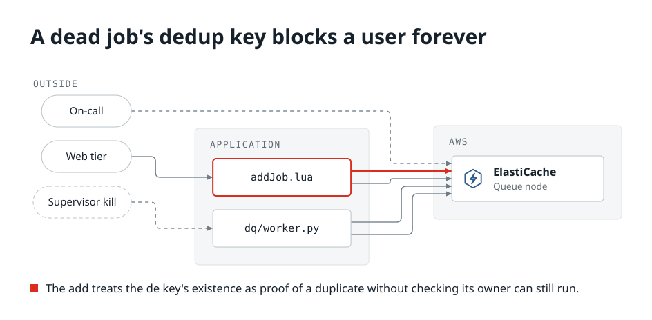

# A dead job's dedup key blocks a user forever

A job queue on ElastiCache keeps a user's deduplication key after its job is gone, so new jobs report "deduplicated" and never run.

## The system
`dq` is a job queue with no server process. Web processes run `dq add`, workers run `dq worker`, and every state change is an atomic Lua script on one ElastiCache node. A per-user job carries a dedup id, usually an email. The key `dq:<queue>:de:<id>` names the job holding that id, and `dq:<queue>:dn:<id>` keeps the latest data for keep-last jobs, to run after the current one.

## What goes wrong
During a database outage, the supervisor killed hung workers and on-call removed jobs by hand. Afterwards:
- The queue drained, yet every add for some users returned `"deduplicated": true` against an old job, until their `de` keys were deleted by hand.
- Some users' last account sync never ran, though its add was deduplicated against a running sync.

## Where the issue is
`addJob.lua` treats the existence of the `de` key as proof of a duplicate and never asks whether the job it names can still run. A job failed by the stall limit in `moveStalledJobsToWait.lua` skips the release and handover that `moveToFinished.lua` performs. Manual removals leave the key behind too. `moveToFinished.lua` also refuses a job whose id left the active list, and the keep-last check reads only that list, ignoring the lock.

The right shape judges the owner atomically inside the add, from what makes a job run: its lock and its place in wait, active or delayed, not its `state` label.

## What a correct fix must do
- Reclaim the id when its owner will never run again.
- Hold the id through kills, stall requeues, backoff, and any handler still holding its lock.
- Let `--ttl-ms` throttle keys hold until they expire, even after the job is gone.
- Run kept data after a stall-limit failure, and finalize a job taken out of the active list.
- Discard data kept for a gone owner, so older data never runs after newer.

## How it is graded
The tests run scheduled phases on a fresh node. With no worker alive, they delete job records, remove ids from lists, and race 8 adds on stale ids. A pool of 5 workers then runs hung handlers, SIGKILLed past the stall limit, plus one that raises and enters backoff. Duplicate adds probe every second. They check adds create or deduplicate correctly, runs never overlap, racing adds create one job, throttle windows survive, and syncs never move to older data.

## Why it is hard
No expiry satisfies both needs: the key must outlast any outage yet stop holding once its owner is gone, including on paths that never run release code. Kept data couples to all those paths, and a live handler can outlast its id in the active list.

## Real-world basis
Modelled on a failure publicly reported against an open-source job queue.

## Task facts

| | |
|---|---|
| Task | `swe-cloud/if-elasticache-new-jobs-silently-deduplicated` |
| Type | Issue fixing |
| AWS services | ElastiCache |
| Language | Python |
| Runtime | Local AWS-compatible emulator with live service engines. No internet access. |
| Hidden tests | 19 test functions |
| Expert estimate | 4 hours |
| Agent time limit | 1 hour |
| Resources | 4 CPUs, 8 GB memory |
