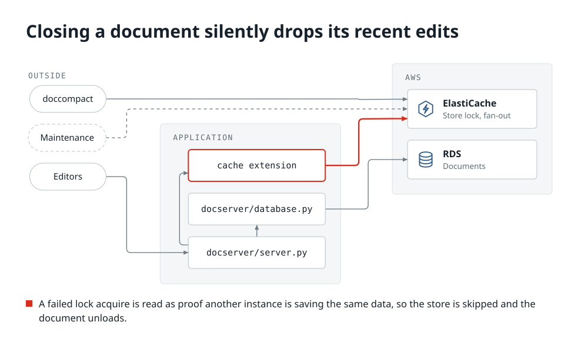

# Closing a document silently drops its recent edits

A collaborative document server unloads closed documents without saving them when its ElastiCache store lock is busy or unreachable, and a plain save would overwrite other instances' edits in RDS.

## The system
A fleet of `docserver` instances lets clients co-edit documents, each held in memory as a mergeable CRDT state. Instances share one ElastiCache node and one RDS `documents` table. ElastiCache carries best-effort update fan-out, so an instance can hold edits another never received, plus a short per-document store lock. When an instance's last connection to a document closes, it stores the full state to the row and unloads. A platform job, `doccompact`, rewrites rows under that lock without checking versions.

## What goes wrong
- Users close a document, reopen it, edits gone.
- During an ElastiCache maintenance, every document closed in a roughly 40 second window lost its recent edits.
- Logs show `store of <doc> skipped: Another instance is already storing this document`, then `unloaded <doc>`, and no row write.
- After RDS maintenance, a few documents sat in memory with zero connections, logs ending at a connection error.

## Where the issue is
The cache extension treats a failed lock acquire as proof another instance is saving the same data. It raises a skip, the store never happens, and the document unloads. That assumption is false twice: the holder may lack these edits, and an outage produces the same error as contention. Removing the skip exposes `database.py`, whose upsert writes a full snapshot with last-writer-wins, and which never retries a reset connection.

The right shape waits for the lock, merges the current row in, and writes conditionally on `documents.version`, retrying on conflict.

## What a correct fix must do
- Get every acknowledged edit into the row before unloading, within the 15 second budget.
- Never commit a version that drops an edit from an earlier version.
- Wait for a held lock, keep its own lock alive through slow stores, and go ahead without it only when ElastiCache is unreachable.
- Never delete or overwrite a lock another writer set.
- Keep `/healthz` answering through outages. Dropping the lock does not count.

## How it is graded
Tests run real instances against real cache and database engines through proxies that can refuse connections. A peer holds the lock and an open row transaction, then commits an edit the instance never saw. Other scenarios let the lock expire, terminate the instance's database backend, have a compaction job hold the lock for 8.5 seconds, and take either store down. Every committed version in the history table is checked for lost edits.

## Why it is hard
Storing without waiting races compaction, which trusts the lock and never rechecks the version. Waiting too long misses the budget. A slow store can outlive a one-second lock.

## Real-world basis
Modelled on a failure publicly reported against an open-source collaborative editing server, where a failed store lock unloaded documents unsaved.

## Task facts

| | |
|---|---|
| Task | `swe-cloud/if-elasticache-rds-collab-docs-lose-edits-on-close` |
| Type | Issue fixing |
| AWS services | ElastiCache, RDS |
| Language | Python |
| Runtime | Local AWS-compatible emulator with live service engines. No internet access. |
| Hidden tests | 9 test functions |
| Expert estimate | 4 hours |
| Agent time limit | 1 hour |
| Resources | 4 CPUs, 8 GB memory |
