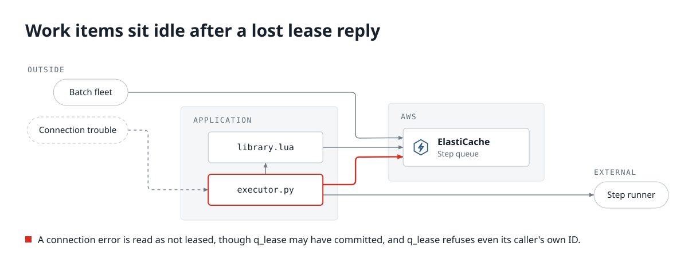

# Work items sit idle after a lost lease reply

A step queue on ElastiCache leases items through server-side functions. When a committed lease's reply is lost, the executor walks away and the item waits for the scavenger.

## The system
stepq sits behind workflow runs. Items live in an ElastiCache cluster, in a hash plus sorted sets for ready and leased work. Executors in `stepq/executor.py` lease due items through a function library, `stepq/library.lua`, call a step runner over HTTP, rotate the lease meanwhile and remove the item at the end. Another team's batch fleet calls the same functions, and scavenger passes requeue expired leases. The caller generates each lease ID, and its timestamp is the expiry.

## What goes wrong
- A next step waits 10 to 13 seconds against a 3 second target.
- One executor logs `lease call failed` with a timeout or connection error just as the item comes due.
- Later a scavenger logs `scavenged lost items`, and the item then runs fine.
- It lines up with a slow shard or connection resets.

## Where the issue is
`lease_item()` in `executor.py` treats any connection error as "not leased" and moves on. But `q_lease` may have committed, so the item stays leased until expiry. A retry would not help, since `q_lease` answers "already leased" even to the caller's own ID.

More sits behind that. `q_requeue`, `q_dequeue` and `q_scavenge` ignore who holds the lease. Executors stamp queue times from host clocks, not the shard's. And `run_step` treats the load balancer's `504` as a failed step, though in this deployment the run carries on.

The right shape retries under the same lease ID, makes every release conditional on the caller's lease, and keeps a durable run identity in the item.

## What a correct fix must do
- Start an item within 3 seconds when its lease reply was lost, even during a deploy's SIGTERM.
- Never run an item twice, or while another executor or the batch fleet holds it.
- Pick up a dead executor's item only after its lease expires, within 15 seconds.
- Keep the documented functions working for the batch fleet.
- Run again only after a real step failure.

## How it is graded
One scenario runs three executors against a fresh ElastiCache cluster, on host clocks a few seconds behind the shard. A proxy loses committed replies, slows calls and drops a call while the batch fleet takes the item. Hosts die as a lease commits or right after a step finishes, a deploy restarts an executor, and a stale scavenger pass fires. A sampler records stored leases, and the tests check run counts and delays.

## Why it is hard
Retrying needs recognition of one's own ID, and conditional releases, or a slow caller frees someone else's item. The wrong clock breaks both. The run identity must survive scavenging, not a requeue.

## Real-world basis
Modelled on a public fix to an open-source workflow engine's in-memory queue.

## Task facts

| | |
|---|---|
| Task | `swe-cloud/if-elasticache-work-items-abandoned-after-lost-reply` |
| Type | Issue fixing |
| AWS services | ElastiCache |
| Language | Python |
| Runtime | Local AWS-compatible emulator with live service engines. No internet access. |
| Hidden tests | 12 test functions |
| Expert estimate | 4 hours |
| Agent time limit | 1 hour |
| Resources | 4 CPUs, 8 GB memory |
