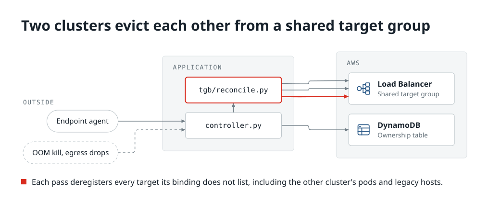

# Two clusters evict each other from a shared target group

Two cluster controllers and hand-added hosts share one ELBv2 target group. Each controller treats the group as its own and deregisters every target it does not recognise.

## The system
One Python controller per cluster reads a binding file, written by that cluster's endpoint agent, listing the pods to keep registered as IP targets in the `web` target group. Every AWS call goes through a per-cluster egress proxy that drops connections. The network team also registers legacy hosts by hand. ELBv2 records nothing about who registered a target, so the DynamoDB table `tgb_ownership`, keyed by cluster and target, was provisioned as each cluster's record of what it owns.

## What goes wrong
- Legacy hosts drained within seconds of the controllers starting, and vanish again when re-added.
- One cluster's pods drop out whenever the other cluster's controller starts, then return.
- After one of cluster-a's nodes died, some of its running pods dropped out for several seconds once its controller came back.

## Where the issue is
In `tgb/reconcile.py`, a pass compares the whole group with the binding and deregisters any target it does not match, and a deleted binding removes everything listed. `controller.py` creates a DynamoDB client but never uses it, so the table stays empty. Listings also come from a cache in `tgb/targets.py` that lives 300 seconds, and an older binding file is obeyed like a newer one.

The correct shape uses ownership items as the only licence to deregister: written before `RegisterTargets`, deleted only after `DeregisterTargets` succeeds, with decisions made from a fresh listing.

## What a correct fix must do
- Keep each cluster's endpoints registered, remove its own departed pods, and leave everything else alone.
- Keep an item for every target a cluster has in the group, at all times.
- Skip deregistering an address another cluster's item now names, since addresses are recycled.
- Durably record the highest binding generation acted on, and ignore older files.
- Clear a deleted cluster's targets and items, then exit 0.

## How it is graded
One scripted run starts both controllers behind test-owned proxies on a local AWS-compatible emulator, sampling the group throughout. Proxies SIGKILL a controller after a `RegisterTargets` applies, lose a `DeregisterTargets`, or drop responses while the controller lives. Other phases hand a pod's address to the other cluster, write an older binding after an agent failover, and delete a binding while its controller is down. Tests check convergence after each phase, legacy hosts, table contents and who deregistered what.

## Why it is hard
Item order must survive a kill on either side of every call. A leftover item normally licenses deregistration, yet recycling can make it point at another cluster's live pod. A binding that goes backwards would remove live pods, and nothing on local disk survives a restart.

## Real-world basis
Modelled on a failure publicly reported against an open-source cluster ingress controller sharing a target group.

## Task facts

| | |
|---|---|
| Task | `swe-cloud/if-elb-dynamodb-multicluster-target-group-evictions` |
| Type | Issue fixing |
| AWS services | Load Balancer, DynamoDB |
| Language | Python |
| Runtime | Local AWS-compatible emulator. No internet access. |
| Hidden tests | 17 test functions |
| Expert estimate | 4 hours |
| Agent time limit | 1 hour |
| Resources | 2 CPUs, 3 GB memory |
