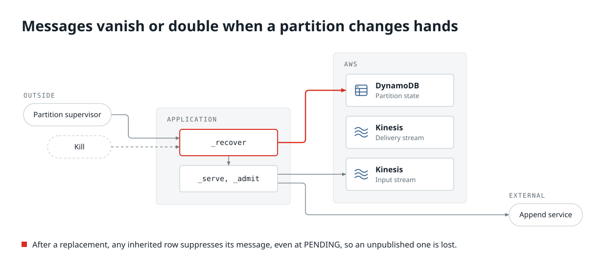

# Messages vanish or double when a Kinesis partition changes hands

A partition worker dedups Kinesis messages with DynamoDB rows. A replacement cannot tell from a row whether the killed worker delivered the message, so trusting the row loses messages and republishing bills twice.

## The system
`worker.py` owns one partition. It reads a Kinesis input stream, and for each new `messageId` writes a `SEEN#<messageId>` row in DynamoDB, then asks the local append service, `adapter.py`, to write the message to the delivery stream, and moves the checkpoint. A message counts as delivered only when its record is in that stream. A supervisor kills unresponsive workers without warning and starts a replacement on the same state.

## What goes wrong
- Tuesday: after a replacement, the checkpoint said fully processed, but a message accepted just before the replacement was absent. The state table still had its row.
- Thursday: during a replay after a replacement, one `messageId` had two records with different sequence numbers. The customer was billed twice.

## Where the issue is
In `worker.py`, `_recover` loads every seen row into memory, and `_admit` suppresses any message that has a row, ignoring `publication_state`. A row stuck at `PENDING` is treated as delivered, so its message is dropped and the checkpoint moves past it.

Republishing `PENDING` rows does not help. The row is written before the publish, so it looks the same whether or not the record reached the stream. Only the delivery stream separates the two cases. The right shape reads that stream during recovery up to the `recovery_boundary` record, and keeps reading while `GET /pending` shows the append service still holds an accepted request.

## What a correct fix must do
- Get every accepted message into the delivery stream exactly once, with its original payload.
- Finish with the checkpoint at the last position, no row undecided, and `QUIESCED` on request.
- Deliver the in-flight message within 30 seconds of the replacement starting, and settle within 45.
- Keep the pause announcement, publish only through `POST /publish`, and start nothing that outlives the worker.

## How it is graded
Each attempt provisions fresh streams and a table, runs a real worker through a test-owned append service, and kills it with one message in flight. Three histories follow: killed before any publish, killed after the record landed with the response withheld, and killed while the service holds an accepted request whose record lands 26 seconds into recovery. The tests count raw records on the delivery stream and check payloads, the final checkpoint, row states, shutdown and timing.

## Why it is hard
The killed worker leaves identical state in all three histories. Trusting the row loses a message, and republishing duplicates one. Even reading the stream fails if it stops at the boundary, since a late record can land after it.

## Real-world basis
Modelled on a publicly described design for exactly-once delivery with a per-partition dedup store, an engineering write-up rather than a bug report.

## Task facts

| | |
|---|---|
| Task | `swe-cloud/if-kinesis-dynamodb-dedup-worker-handoff-duplicates` |
| Type | Issue fixing |
| AWS services | Kinesis, DynamoDB |
| Language | Python |
| Runtime | Local AWS-compatible emulator. No internet access. |
| Hidden tests | 6 test functions |
| Expert estimate | 4 hours |
| Agent time limit | 1 hour |
| Resources | 2 CPUs, 3 GB memory |
