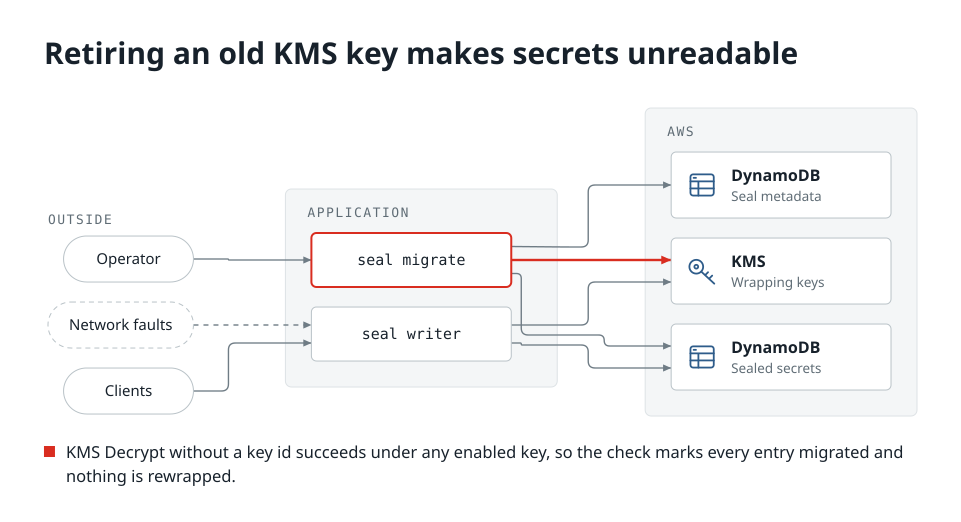

# Retiring an old KMS key makes secrets unreadable

A DynamoDB secret store's key migration reports success while rewrapping nothing. Disabling former KMS keys breaks reads, and delayed writers and retries can undo it.

## The system
A small Python service stores secrets as KMS envelopes in the DynamoDB table `seal_entries`: each value has its own AES key, wrapped by a KMS key. `seal_meta` holds the operator's chosen key. To change keys, the operator updates that item or retargets an alias, runs `python -m seal migrate`, waits for a `status=complete` record, then retires every former key. Clients keep a request id across retries.

## What goes wrong
- The migration command reported success and normal reads looked healthy.
- Retiring the former keys made some secrets unreadable. Re-enabling them restored service, and retirement was rolled back twice in a week.
- Clients report that reconnecting and retrying a put after a lost response can bring back an older secret.

## Where the issue is
In `seal.py`, `migrate()` decides an entry is done when `wrapper.decrypt(item)` succeeds. KMS `Decrypt` without a key id uses whichever key wrapped the blob, so it succeeds for every enabled former key and nothing gets rewrapped. Writers read the key once at startup and commit with a plain `PutItem`, so a delayed writer can land an old-key envelope after completion, and a rewrap can overwrite a newer put. Retry detection only looks at the entry's latest request, so an older retry writes its old value again. The right shape is a `TransactWriteItems` that checks a published target key and the entry's revision and records the request.

## What a correct fix must do
- Leave every entry wrapped by the target key at completion, and keep that true after delayed writers arrive.
- Never let a rewrap undo a put, and keep each entry's application revision unchanged by rewraps.
- Let a killed migrator rerun, while requests stay within five seconds.
- Apply a retried request exactly once. Reusing its id with different input must fail.
- Keep the stored envelope format readable by the backup tooling. Plaintext copies or disabling keys do not count.

## How it is graded
The tests run real writer and migrator processes through fault proxies, with secrets under two former keys, for both a config change and an alias retarget. One put's write is held until two seconds after completion. Others lose their request or response. The migrator meets a concurrent put and is killed mid-run. The tests then disable the former keys and decrypt everything independently, checking wrapping keys, values and revisions.

## Why it is hard
The obvious repair, a `key_arn` comparison, passes until a delayed write arrives. Fencing that write means checking routing state and writing the entry in one transaction. Exact-once retries need durable receipts that outlive newer puts, in that same write.

## Real-world basis
Modelled on a failure publicly fixed in an open-source KMS wrapping library's seal migration.

## Task facts

| | |
|---|---|
| Task | `swe-cloud/if-kms-dynamodb-seal-key-retirement-breaks-reads` |
| Type | Issue fixing |
| AWS services | DynamoDB, KMS |
| Language | Python |
| Runtime | Local AWS-compatible emulator. No internet access. |
| Hidden tests | 1 test function |
| Expert estimate | 4 hours |
| Agent time limit | 1 hour |
| Resources | 2 CPUs, 3 GB memory |
