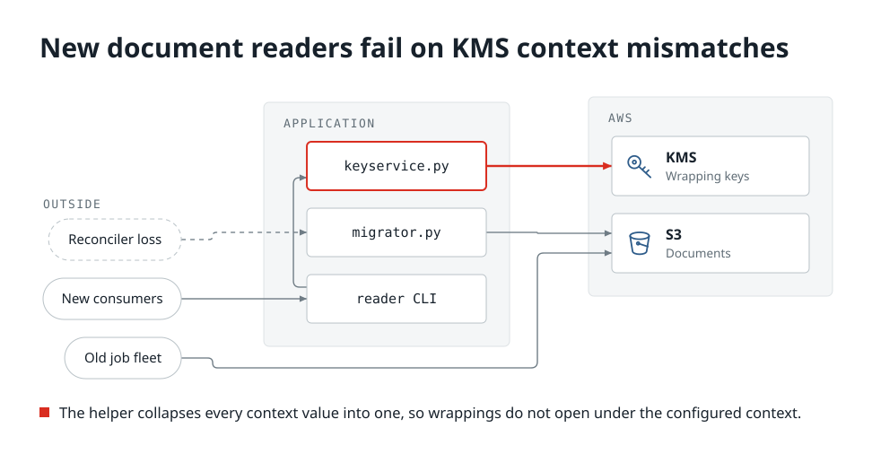

# New document readers fail on KMS context mismatches

Documents written by an old KMS client fail in new readers, and the reconciliation service meant to fix them can erase old edits.

## The system
Each document is one JSON object in S3, encrypted with a data key that KMS keys wrap. Threshold documents split that key across numbered groups. Old jobs still read, edit and rotate these documents with a fixed client. New callers use a new reader CLI, and two `migrator.py` reconcilers should make every document work for both, until a barrier object in S3 announces the old fleet has gone.

## What goes wrong
- Some documents that the old deployment can open fail in the new one with KMS errors.
- Running the reconciliation service has not made the rollout reliable.
- Old jobs keep editing and cannot be stopped early.

## Where the issue is
`keyservice.py` builds its KMS request with a shared cell, so every context value collapses into one. KMS authenticates encryption context, so such a wrapping only opens under the collapsed context, not the configured one. `migration.py` then stays on that path: `candidate()` splits the key afresh and re-encrypts every entry through the same helper, ignoring Decrypt-only keys and old readers' group selection, and `recover()` tries few contexts. `migrator.py` publishes with a plain `PutObject`, which can erase an old edit.

The right shape keeps existing wrappings, adds direct-context ones, and publishes with `If-Match`.

## What a correct fix must do
- Read every document before reconciliation, within 10 seconds.
- Give every configured group and ARN a direct-context wrapping in an authenticating quorum, within 15 seconds of startup or any old write.
- Keep every working old read, in every ordering, until retirement.
- Never lose an acknowledged old edit, and never publish a partial repair.
- Use existing ciphertexts on Decrypt-only keys and new wrappings elsewhere.
- Remove obsolete wrappings within 20 seconds of the barrier, never by a time estimate.

## How it is graded
Two reconcilers and every reader run through test-owned proxies that deny Encrypt to Decrypt-only keys. At publication, the proxies SIGKILL both first-generation reconcilers and let old edits land just before the write. An old rotate runs at 20 seconds, and the barrier appears between 45 and 55 seconds. Every second the tests open each document as an old reader, in each request ordering, check direct quorums, and run a new reader. Final checks require convergence and every accepted edit.

## Why it is hard
Adding a correct wrapping can break an old reader: one that used to skip a group now opens it and combines shares from different sharings, with no retry. So some additions need compatibility entries ahead of them. Archives may hold several current share refreshes, and no single one may cover every failover selection, while restricted keys cannot be rewrapped. Old writers ignore locks too.

## Real-world basis
Modelled on a KMS context bug publicly fixed in an open-source secrets encryption tool.

## Task facts

| | |
|---|---|
| Task | `swe-cloud/if-kms-s3-document-reader-rollout-failures` |
| Type | Issue fixing |
| AWS services | S3, KMS |
| Language | Python |
| Runtime | Local AWS-compatible emulator. No internet access. |
| Hidden tests | 2 test functions |
| Expert estimate | 4 hours |
| Agent time limit | 1 hour |
| Resources | 2 CPUs, 3 GB memory |
