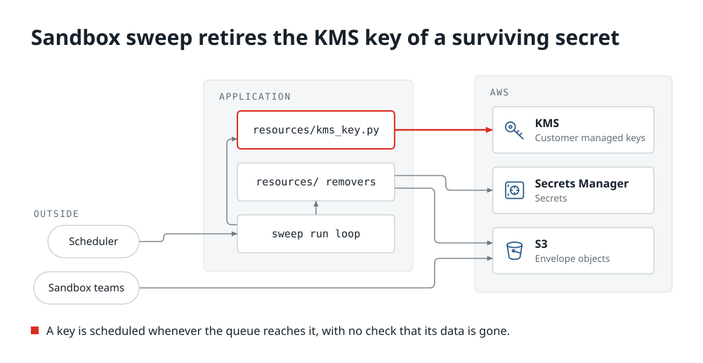

# Sandbox sweep retires the KMS key of a surviving secret

A sandbox cleanup job schedules KMS keys for deletion in the same run that failed to delete the data under them, leaving a protected secret that nobody can decrypt.

## The system
A scheduled Python sweep empties sandbox accounts through an account gateway that refuses to delete secrets tagged `DeletionProtection=true`. Each resource type has a lister and a remover: S3 objects and Secrets Manager secrets are backed up and deleted, then customer managed KMS keys get `ScheduleKeyDeletion`. Data is envelope-encrypted: secrets name their key in `KmsKeyId`, objects in `kms-key-id` metadata, by ARN or bare ID. A run loop retries items across passes, then exits 0 or gives up with exit 3.

## What goes wrong
- A sweep could not delete `payments/ledger-db` because of deletion protection, and in the same run scheduled deletion of its key.
- Later sweeps log the key as `filtered`: already in `PendingDeletion`.
- The secret cannot be decrypted, so owners can neither read nor back it up.
- Cancelling the deletion by hand left the key `Disabled`, needing a ticket to security.

## Where the issue is
`resources/kms_key.py` calls `ScheduleKeyDeletion` whenever the queue reaches a key, assuming everything encrypted under it has already gone. A consumer can fail to delete, be filtered, appear after the scan, or be unreadable. In KMS, a pending key refuses all cryptographic operations at once, and `CancelKeyDeletion` leaves it `Disabled`.

The check belongs in key removal, decided from the live account on every pass, refusing when unsure. The run loop's give-up rule also counts held items as progress, so a held key loops until the scheduler kills the sweep.

## What a correct fix must do
- Keep a key enabled while anything encrypted under it exists, matching both ARN and ID references.
- Leave the key alone when any listing or read fails.
- Retire freed keys in the same sweep, and reconsider held keys in the next.
- Finish inside two minutes, and exit 3 when items remain.
- Keep backups, filters and deletion protection. Each sweep starts fresh, so local state does not count.

## How it is graded
Tests create five keys with secrets and objects in mixed reference forms, then run three real sweeps through a recording gateway. The first has a protected secret, throttled deletion, a kept bucket that fails reads at first, and an object written after the scan. Owners then remove protection and the kept object before later sweeps. Tests check exit codes, key states, that survivors still decrypt, backups, and that no `ScheduleKeyDeletion` was recorded while a consumer existed.

## Why it is hard
Comparing against the scan's queue misses filtered and late consumers. Holding keys then breaks termination, and exiting too early would strand keys that a throttled delete was about to free.

## Real-world basis
Modelled on a failure publicly reported against an open-source AWS account cleanup tool, where a key was scheduled before its consumer was removed.

## Task facts

| | |
|---|---|
| Task | `swe-cloud/if-kms-secretsmanager-key-retired-under-live-secret` |
| Type | Issue fixing |
| AWS services | S3, Secrets Manager, KMS |
| Language | Python |
| Runtime | Local AWS-compatible emulator. No internet access. |
| Hidden tests | 12 test functions |
| Expert estimate | 4 hours |
| Agent time limit | 1 hour |
| Resources | 2 CPUs, 3 GB memory |
