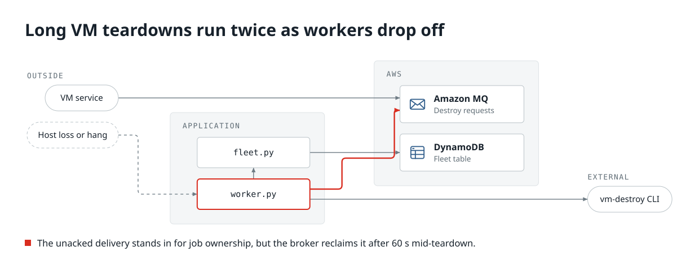

# Long VM teardowns run twice as workers drop off

A VM destroyer holds an Amazon MQ delivery open for a whole teardown. The broker's acknowledgement timeout closes the channel, the worker exits, and another worker starts the same teardown again.

## The system
The VM service publishes one message per VM to the `vm.destroy` queue on another team's Amazon MQ broker. Destroyer workers, one per host, consume them and run the cloud team's `vm-destroy` CLI as a child process. It prints `progress <n>` every two seconds or so, takes minutes for big VMs and is not idempotent. A DynamoDB fleet table holds each VM's `state`, and the capacity scheduler releases quota when it reads `destroyed`.

## What goes wrong
- Workers drop off `vm.destroy` one after another. On a busy day the queue backs up with no consumers.
- The cloud's teardown audit shows some of the biggest VMs with two teardowns running at once.

## Where the issue is
`on_request` in `destroyer/worker.py` keeps the delivery unacknowledged until `vm-destroy` exits, so the delivery doubles as job ownership. The platform declared `vm.destroy` with a 60 second delivery acknowledgement timeout. A longer teardown makes the broker close the channel and requeue the message. The worker treats that as fatal and exits, and nothing restarts it. The requeued message goes to another worker, and `mark_destroying` in `fleet.py` overwrites state without any condition, so a second teardown starts beside the first.

The right shape acknowledges quickly and moves ownership into a conditional, renewable lease on the fleet record, with something durable on the broker to bring the job back.

## What a correct fix must do
- Complete exactly one `vm-destroy` run per VM, however long it takes.
- Restart a teardown within 45 seconds when its worker dies.
- Take over a hung run within 45 seconds of its last progress line, even with a healthy worker and connection.
- Keep idle workers subscribed so the queue drains.
- Leave `vm.destroy` as declared. Moving work to another queueing service does not count.

## How it is graded
One live run starts six workers against a fresh broker and fleet table, with a 180 second teardown among short ones. One worker's process group gets SIGKILL a few seconds into a teardown. Another teardown gets SIGSTOP right after reporting progress. The cloud API records every attempt out of the workers' reach, and a sampler reads queue and consumer counts every second. The tests check run counts, takeover delays, overlap, fleet state, idle subscriptions and the queue's definition.

## Why it is hard
Acknowledging early removes the crash protection the unacknowledged delivery was giving. So the job needs a new durable pending form on the broker, and ownership needs a lease tied to progress rather than to the worker being alive. Stale owners must be fenced too.

## Real-world basis
Modelled on a public incident postmortem from a hosted CI service, involving long jobs and a message broker's consumer timeout.

## Task facts

| | |
|---|---|
| Task | `swe-cloud/if-mq-dynamodb-long-teardown-double-run` |
| Type | Issue fixing |
| AWS services | Amazon MQ, DynamoDB |
| Language | Python |
| Runtime | Local AWS-compatible emulator with live service engines. No internet access. |
| Hidden tests | 12 test functions |
| Expert estimate | 4 hours |
| Agent time limit | 1 hour |
| Resources | 4 CPUs, 8 GB memory |
