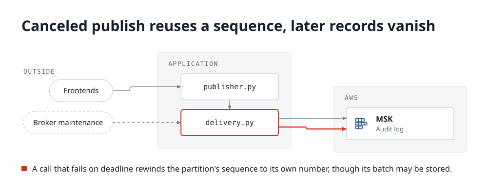

# Canceled publish reuses a sequence, later records vanish

An MSK audit publisher rewinds its producer sequence when a call hits its deadline, so the broker takes the next event for a duplicate, returns an old offset, and the event is never stored.

## The system
Frontends POST audit events to `publisher.py`, each with an id and a hard `deadline_ms`. `delivery.py` publishes one keyed record per call to the two-partition `ledger` topic on MSK, using idempotent producer batches with `acks=all`. Each partition pipelines up to four calls at once, each with its own producer sequence number. The broker remembers the last five sequence ranges per partition, and a repeated range gets the earlier offset back, without comparing keys or values.

## What goes wrong
- The service reports successful publishes for events the downstream audit reader cannot find.
- It appears around broker maintenance and request cancellations.
- A normal low-load run looks healthy.

## Where the issue is
In `delivery.py`, `DeliveryBuffer.fail` sets the partition's next sequence back to the failed call's number. But that call was already sent: with `acks=all`, a timeout or dropped connection says nothing about whether the batch was appended, and the request may still arrive. The next event then goes out under the same sequence. If the first batch landed, the broker treats the new event as a retry and answers with the old offset, so the service acknowledges a record that does not exist.

The correct shape never rewinds a sequence that was sent. It stops admissions, lets live calls resolve in their current producer identity, then moves only the calls the broker definitely rejected onto a new identity starting at sequence zero.

## What a correct fix must do
- Make every `acked` reply name that exact key and value at that offset.
- Never store a record twice.
- Answer within `deadline_ms` plus 500 ms, and stop sending a failed event.
- Keep later calls and the other partition working.
- Stay inside the quota on new producer identities. Healthy calls earn none.

## How it is graded
The publisher runs against a broker provisioned through a local AWS-compatible emulator, behind a test-owned network gateway. The gateway appends a write then returns a retryable error, drops it, or delivers it late, and holds replies so several calls overlap on a partition. After the run, the tests consume the topic directly and compare each reply with the stored records. They also check deadlines, duplicates, sends after failure, and identities on the wire.

## Why it is hard
A sequence rejection says only that this attempt failed, not what happened to earlier ones. Successors may already be stored, so they cannot simply be renumbered. Retiring an identity has to wait for live calls, yet those calls keep their own deadlines, and identities are rationed.

## Real-world basis
Modelled on a failure publicly reported against an open-source client library for a streaming platform, where canceled requests reused sequence numbers.

## Task facts

| | |
|---|---|
| Task | `swe-cloud/if-msk-audit-publisher-loses-records-on-deadline` |
| Type | Issue fixing |
| AWS services | MSK |
| Language | Python |
| Runtime | Local AWS-compatible emulator with live service engines. No internet access. |
| Hidden tests | 6 test functions |
| Expert estimate | 4 hours |
| Agent time limit | 1 hour |
| Resources | 4 CPUs, 8 GB memory |
