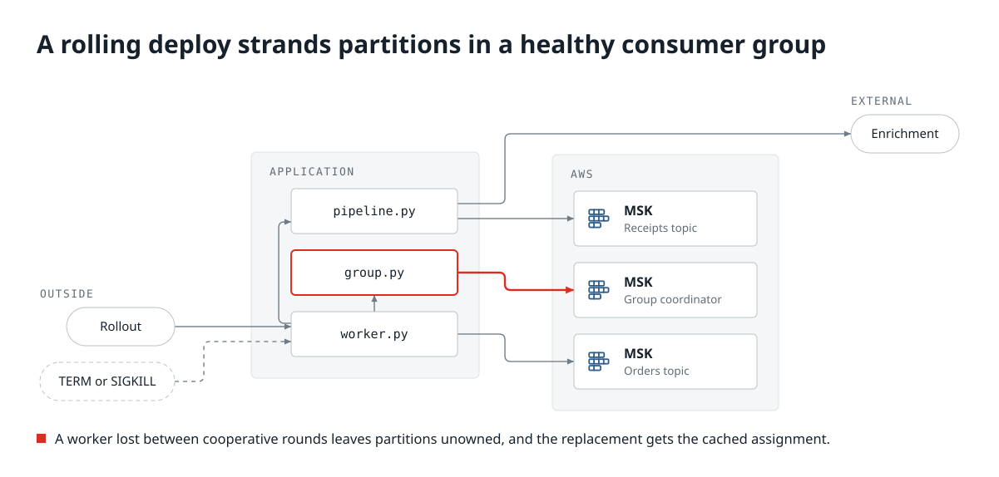

# A rolling deploy strands partitions in a healthy consumer group

Python workers on MSK use static membership. A worker lost mid-rebalance leaves partitions unowned while the group reads Stable, and commits can run ahead of durable receipts.

## The system
Orders workers consume one MSK topic, call an HTTP enrichment service for each record, publish a receipt to a receipts topic and commit offsets to the consumer group. `group.py` runs the classic JoinGroup and SyncGroup protocol with static instance IDs and cooperative assignment, `worker.py` runs fetching, commits and shutdown, and `pipeline.py` runs enrichment concurrently. A replacement reuses its predecessor's ID, so a quiet restart inside the session causes no rebalance.

## What goes wrong
- Orders lag stops moving during a worker rollout, while the group still looks healthy.
- Another restart does not clear the backlog, and a killed worker does the same.
- Receipts fall behind the committed input position.

## Where the issue is
Cooperative rebalancing takes two rounds: the old owner gives a partition up, then rejoins so the coordinator can assign it. If that owner dies between rounds, the partition has no owner and nobody asks for another round. Its replacement receives the static member's cached assignment, and `group.py` has no way to see the gap. The right shape audits coverage against coordinator state and, after a normal transfer's allowance, forces a real rebalance by changing a member's subscription.

`worker.py` also advances `offsets` at fetch time, and `pipeline.py` raises its safe point on any later completion, so a commit can cover inputs with no receipt. Revocation does not drain in-flight work, and the heartbeat shares the main loop with a blocking revocation callback.

## What a correct fix must do
- Return full, exclusive ownership within 30 seconds of a replacement starting, and commit a new batch within 20 more.
- Leave ordinary transfers alone for at least 10 seconds, and keep quiet restarts of up to 38 seconds free of rebalances.
- Commit only a contiguous frontier of published receipts.
- Finish revoked partitions before notifying the observer.
- Keep the session at 45 seconds. Shortening it does not count.

## How it is graded
Real workers run against a real broker with enrichment slow enough to reorder completions. In transfer tests, a new worker triggers a revocation, the test holds the callback, then the old worker gets SIGTERM or SIGKILL and a replacement starts. In quiet tests, a loaded worker stops for 38 seconds and every coordinator snapshot must match the baseline. A background auditor checks that no commit precedes a receipt and no partition has two owners.

## Why it is hard
The stalling feature must stay. A cached assignment is correct for a quiet restart and wrong after an interrupted transfer, and both look alike at the replacement's join. Recovery must also leave transfers in progress alone.

## Real-world basis
Modelled on a failure publicly reported against an open-source client library's static cooperative consumer groups.

## Task facts

| | |
|---|---|
| Task | `swe-cloud/if-msk-consumer-group-stalls-during-rolling-deploy` |
| Type | Issue fixing |
| AWS services | MSK |
| Language | Python |
| Runtime | Local AWS-compatible emulator with live service engines. No internet access. |
| Hidden tests | 2 test functions |
| Expert estimate | 4 hours |
| Agent time limit | 1 hour |
| Resources | 4 CPUs, 8 GB memory |
