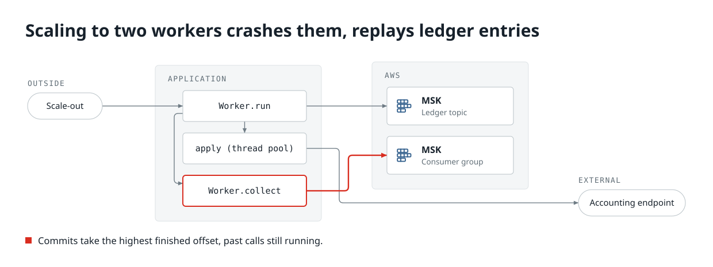

# Scaling to two workers crashes them and replays ledger entries

An MSK consumer sends irreversible accounting calls in parallel. Scaling from one member to two makes it crash on rejected commits, skip unfinished offsets, and hand partitions over too early.

## The system
`worker.py` reads the `ledger` topic in MSK as part of a cooperative consumer group and calls an accounting endpoint with `POST /apply` for each record. Calls run in a thread pool, up to eight outstanding per partition, because each can take 1.5 seconds. The endpoint has no idempotency key: every 200 is a real application. Progress is stored only as manually committed group offsets, which is where a new owner resumes after `OffsetFetch`.

## What goes wrong
- A routine scale from one member to two causes worker exits, though nothing was killed.
- Ledger entries get replayed, and offsets occasionally jump.
- Partitions stay behind after traffic stops, even with both workers up.

## Where the issue is
Everything is in `worker.py`. `collect` commits the highest finished offset plus one, but calls finish out of order within a partition, so a commit can cover a call still running. During a rebalance the broker rejects commits with `REBALANCE_IN_PROGRESS` or `ILLEGAL_GENERATION`. The worker treats that as fatal, and it never retries, so progress on an idle partition stays uncommitted.

The worker also registers no revocation callback. It releases a partition with calls still running and progress uncommitted, and the new owner resumes from the old offset and applies those entries again.

## What a correct fix must do
- Commit only the completed prefix in delivery order, within one second of it advancing.
- Treat a rejected commit as retryable, with the same member and no extra rejoin, until it lands, even with no new data.
- On revocation or SIGTERM, drain dispatched calls and commit before giving up ownership.
- Keep serving retained partitions throughout, with bursts still applied in budget. Serializing calls does not count.

## How it is graded
Two real workers run against a real broker through a gateway that decodes the group protocol and logs every request. It delays rebalance requests so the broker itself rejects commits: `REBALANCE_IN_PROGRESS` on moving partitions, `ILLEGAL_GENERATION` on a retained one. Of six partitions, three move and three stay. The tests require each record applied exactly once, committed offsets at the log end, every commit covering only applied records, the new owner's first `OffsetFetch` right after the last applied offset, three generations only, and a stable group with both workers alive.

## Why it is hard
Blocking in the revocation callback to drain looks simple, but commits rejected meanwhile must still be retried there, and retained partitions keep serving. Ignoring rejections instead strands progress unless each partition remembers what it still owes.

## Real-world basis
Modelled on a failure publicly reported against an open-source streaming client library, involving commits rejected during cooperative rebalancing.

## Task facts

| | |
|---|---|
| Task | `swe-cloud/if-msk-ledger-consumer-loses-progress-on-scale-out` |
| Type | Issue fixing |
| AWS services | MSK |
| Language | Python |
| Runtime | Local AWS-compatible emulator with live service engines. No internet access. |
| Hidden tests | 8 test functions |
| Expert estimate | 3 hours |
| Agent time limit | 1 hour |
| Resources | 4 CPUs, 8 GB memory |
