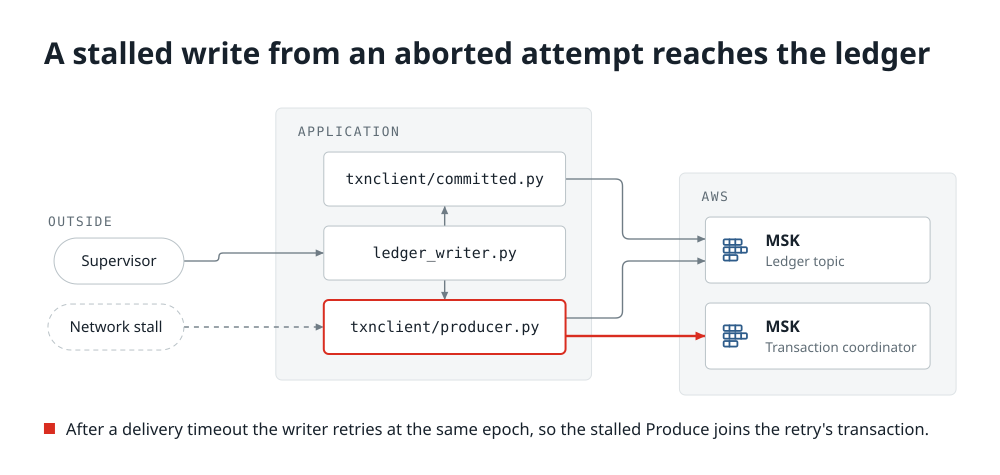

# A stalled write from an aborted attempt reaches the ledger

A transactional settlement writer on MSK retries after a delivery timeout, and the stalled record from the aborted attempt lands inside the retry's transaction and commits.

## The system
A Python service publishes settlement batches to a `ledger` topic on MSK, one transaction per batch, so `read_committed` readers see all of a batch or none of it. An active and a standby instance share one transactional id, and that id is their only coordination: a supervisor can start the standby at any moment, and its `InitProducerId` call takes ownership. `txnclient/producer.py` is the hand-written transactional producer.

## What goes wrong
- Reconciliation finds four committed entries in a three-entry batch: entry `-2` appears twice, one copy stamped `"attempt": 1`.
- The GL export rejects the day's file.
- The writer's log looks healthy: a delivery timeout, an abort, attempt 2 commits.

## Where the issue is
`txnclient/producer.py` treats a delivery timeout as an ordinary abortable error, so the writer retries at the same producer epoch with its sequence counter still running. When a buffering network device finally forwards the stalled Produce, the epoch is current and the sequence is the next one expected, so the record joins the retry's open transaction.

The timeout has to force an epoch bump before the next transaction. But the existing bump sends `InitProducerId` without the writer's own producer id and epoch, which is the new-instance call and takes ownership back from a standby.

## What a correct fix must do
- Keep everything from an aborted attempt out of the committed ledger, whenever the stalled request arrives.
- Abort, retry in the same process and commit again within 15 seconds. Restarting or waiting out the broker does not count.
- Exit 3 when replaced and never take the id back. Never exit 3 while still the owner.

## How it is graded
The tests create an MSK cluster and put a proxy between each writer process and the broker. The proxy holds one Produce, black-holes that connection, and replays the bytes on a fresh connection just before the next successful `AddPartitionsToTxn` response reaches the client. Runs cover no fault, a timeout alone, a plain takeover, and a standby started during recovery, with that recovery landing between or inside the standby's transactions. Each run checks exit codes, recovery time, forbidden API calls, and an independent `read_committed` read: every entry exactly once, last stable offset equal to the high watermark.

## Why it is hard
Bumping with the existing call stops the duplicate but fences a live standby. With the guarded call, the coordinator in this task's cluster can still abort the standby's open transaction on the producer id alone, so the standby's next Produce gets `INVALID_PRODUCER_EPOCH` although nobody replaced it. `send()` reads that as fenced today; it has to abort and let the coordinator's answer decide.

## Real-world basis
Modelled on a failure publicly reported against an open-source distributed log's transactional producer.

## Task facts

| | |
|---|---|
| Task | `swe-cloud/if-msk-ledger-writer-commits-aborted-record` |
| Type | Issue fixing |
| AWS services | MSK |
| Language | Python |
| Runtime | Local AWS-compatible emulator with live service engines. No internet access. |
| Hidden tests | 10 test functions |
| Expert estimate | 4 hours |
| Agent time limit | 1 hour |
| Resources | 4 CPUs, 8 GB memory |
