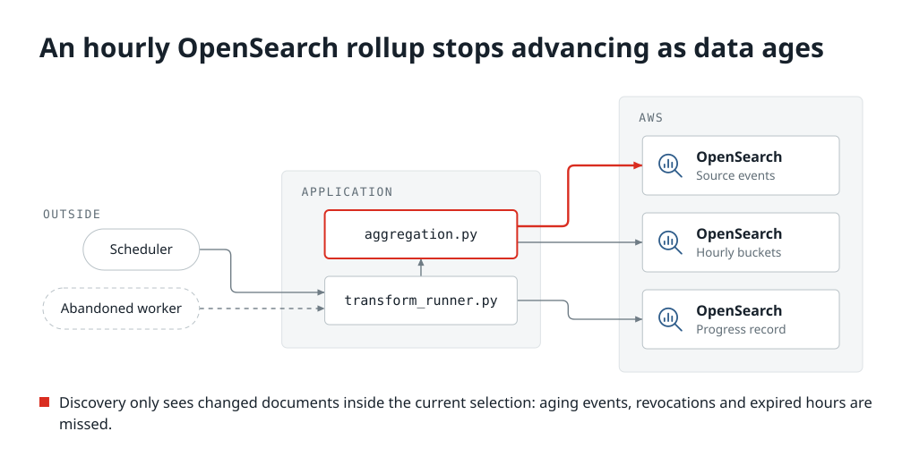

# An hourly OpenSearch rollup stops advancing as data ages

A rolling hourly rollup on OpenSearch only looks at recently changed documents, so aged, revoked and expired events never reach the dashboard. Abandoned workers can also damage it.

## The system
A scheduler starts `transform_runner.py run_once --now-ms <clock>` as a fresh process. It reads events from `metrics-src`, groups them by UTC hour and device, and overwrites bucket documents in `metrics-hourly`, which feeds a rolling 48-hour dashboard with a one-hour holdback. The progress record in `transform-meta` stores each shard's committed global checkpoint and the selection's upper bound. A metered gateway allows 3,000 documents read and 8 target writes per invocation.

## What goes wrong
- Scheduled runs report success while dashboard counts go stale as data ages past the holdback.
- Under target pressure, batches report rejected items, and replacements keep rewriting the same early buckets.
- After a stalled worker is replaced, counts roll back and the progress record reverts when the old worker resumes.
- Expired hours and fully revoked buckets stay on the dashboard.

## Where the issue is
`run_once()` in `transform_runner.py` finds dirty buckets only by `_seq_no` range, intersected with the current selection. An old event entering the window has no new sequence number, so it is never found. A revocation no longer matches the filter. Expired buckets may have no source documents left, so the evidence has to come from the target. Metric rows also only exist for buckets with events, so nothing zeroes an emptied one.

`os_http.py` ignores per-item failures in an HTTP 200 `_bulk` response, and the record is then committed anyway. Ownership is a plain `PUT` and target writes carry no version, so a late request overwrites newer state.

## What a correct fix must do
- Converge on the exact selection for the supplied clock, including late data, corrections and restorations.
- Zero or remove emptied and expired buckets, even after archival.
- Persist unfinished work in the progress record, and never commit past unwritten rows.
- Finish within 64 invocations at 8 writes each.
- Fence metadata with `if_seq_no` and target writes with external versions, so late requests change nothing.
- Stay incremental. Rerunning the backfill exceeds the read allowance.

## How it is graded
The test runs real worker processes through its own metered gateway on a provisioned domain with over 12,000 events. It ingests, corrects, archives and revokes between dispatches, kills workers, and holds an abandoned worker's requests until its replacement has committed, then releases them. After each successful dispatch it compares the target with what it computes from source, and enforces the read allowance.

## Why it is hard
Every discovery route fails somewhere: sequence numbers miss aging data, source misses archived data, and rescanning costs too much. A finite work list then has to survive partial writes, a moving clock and an owner that keeps talking after being replaced.

## Real-world basis
Modelled on a failure publicly reported against an open-source continuous transform feature for OpenSearch.

## Task facts

| | |
|---|---|
| Task | `swe-cloud/if-opensearch-hourly-rollup-stops-advancing` |
| Type | Issue fixing |
| AWS services | OpenSearch |
| Language | Python |
| Runtime | Local AWS-compatible emulator with live service engines. No internet access. |
| Hidden tests | 1 test function |
| Expert estimate | 4 hours |
| Agent time limit | 1 hour |
| Resources | 4 CPUs, 8 GB memory |
