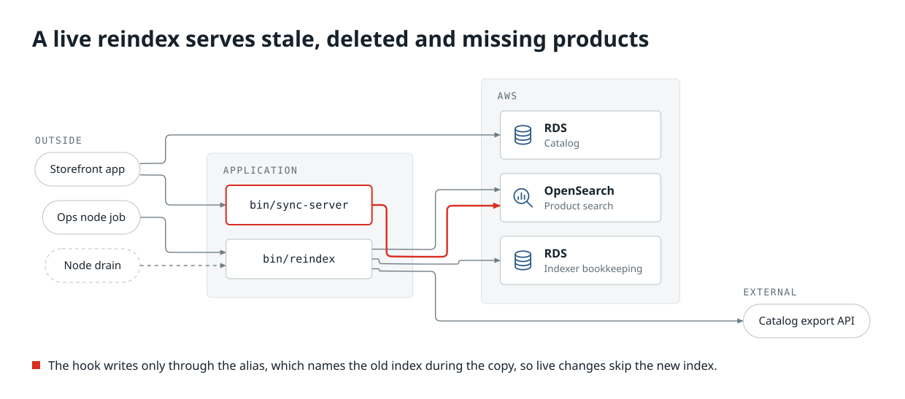

# A live reindex serves stale, deleted and missing products

A zero-downtime OpenSearch reindex behind an alias copies an RDS catalog page by page. Changes made during the copy never reach the new index, so the alias swap serves wrong results.

## The system
Product search in OpenSearch follows an RDS catalog. After each commit the app posts the change to `sync-server`, which writes through the alias `products`. A schema change needs a full reindex: `bin/reindex` creates a new index, copies the catalog page by page through an export API that holds no snapshot, then moves the alias atomically. The two processes share only OpenSearch and the indexer's own RDS schema, `reindex_aux`.

## What goes wrong
After a reindex under staging traffic, QA found:
- Products edited during the reindex show old prices or names.
- Products deleted during the reindex are back in search.
- Some products created during the reindex cannot be found.
- When an ops node was drained mid-backfill, the rerun started over from the first product.

## Where the issue is
`search_sync/server.py` applies each change only through the alias, which still names the old index during the copy, so the new index never hears about it. `search_sync/reindex.py` writes pages with bulk `index` actions, which would overwrite newer data, then swaps the alias with no reconciliation. Every run creates a fresh index and keeps no cursor. The right shape records the active run in `reindex_aux`, sends live changes to both indices, stops backfill overwriting them, and replays recorded deletes before the swap.

## What a correct fix must do
- Keep changes visible through `products` within 2 seconds, with hook calls under 2 seconds.
- Finish with the alias on one schema-2 index that equals the catalog exactly.
- Make a rerun take over from a paused job, whose sessions and locks stay open, and resume the same run.
- Keep changes made while no reindex process is alive.
- Avoid pausing the storefront or copying the catalog twice. The catalog code stays unchanged.

## How it is graded
The tests load 10,000 products and run about 20 changes a second. A test-owned export API commits updates, deletes and inserts between each page's query and its response, and holds one page for 75 seconds, past the 60 second delete tombstone window. One writer's clock runs 3 seconds behind. The reindex process is frozen with SIGSTOP after a page and rerun 8 seconds later. Probes check freshness through the alias, and the final index is compared with the table.

## Why it is hard
Version numbers on deletes fail because the tombstones expire before a delayed page lands, and `updated_at` cannot order changes across skewed clocks. Deletes therefore need durable records, reapplied after the last page. Takeover cannot wait for the frozen job's lock, which is never released, so the new run must detect a dead holder itself.

## Real-world basis
Modelled on a failure publicly reported against an open-source search integration library's zero-downtime reindex.

## Task facts

| | |
|---|---|
| Task | `swe-cloud/if-opensearch-rds-reindex-loses-live-writes` |
| Type | Issue fixing |
| AWS services | OpenSearch, RDS |
| Language | Python |
| Runtime | Local AWS-compatible emulator with live service engines. No internet access. |
| Hidden tests | 8 test functions |
| Expert estimate | 4 hours |
| Agent time limit | 1 hour |
| Resources | 4 CPUs, 8 GB memory |
