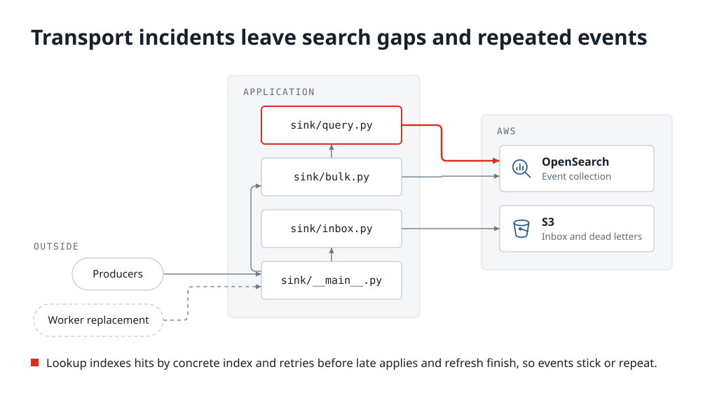

# Transport incidents leave search gaps and repeated events

An event sink writing to OpenSearch through a rolling alias leaves gaps and stores repeats when bulk writes fail ambiguously, workers share an S3 inbox, or processes restart.

## The system
`python -m sink` takes JSON event batches over HTTP, answers 202 once they are buffered in an S3 inbox of 32 catalog pages, and writes them to OpenSearch with `_bulk` through the `events` alias. Two workers serve the same inbox behind a load balancer. Each business `key` should be stored once, but auto-generated IDs are mandatory, so the store cannot deduplicate. Mapping rejections go to an S3 dead-letter prefix.

## What goes wrong
- Search shows gaps.
- Business keys repeat after retried deliveries and replaced processes.
- Incidents grew more frequent after adding a second worker.
- A restart sometimes clears the backlog and sometimes loses accepted work.

## Where the issue is
`sink/query.py` resolves uncertain writes with `_msearch` on the alias but looks each hit up under its concrete index name, so a found event fails the whole cycle and pending events stick. It also retries after 3 seconds, though this deployment's transport can apply a failed request 8 seconds late, and search shows it only after a 5 second refresh. `sink/inbox.py` writes cached pages with a plain `PutObject`, so workers erase each other's records. `__main__.py` replays every unfinished record as a new write, because nothing records that a bulk was attempted.

The right shape uses `If-Match` on pages, records each attempt before dispatch, and delays any re-send until late applies and refresh have passed.

## What a correct fix must do
- Store one copy per key across retries, redelivery through any worker, and replacements.
- Dispatch a new key within 1 second, and deliver within 25 seconds of acceptance.
- Recover inherited work within 25 seconds of healthy, without blocking intake or peers.
- Dead-letter only permanent item rejections, even across a crash.
- Force no refresh, custom `_id`, deletes or coordination documents in OpenSearch.

## How it is graded
The tests provision a fresh domain and route all OpenSearch traffic through a proxy that returns 500s, closes connections, and applies a held request late, then rolls the index over. Three scenarios run: one process under incidents, a process SIGKILLed twice with writes outstanding, and two workers on one inbox with one killed while its peer continues. Flagged redeliveries arrive throughout. The tests then check one copy per key, dead-letter objects, deadlines, and the proxy's log for banned operations.

## Why it is hard
Waiting long enough to rule out a late write fights the 25 second deadline. A missing search result proves nothing until the late-apply limit plus refresh has passed, and a replacement inherits that doubt about its predecessor's writes. Peers sharing one page contend on every write, while recovery must not touch another worker's records.

## Real-world basis
Modelled on a change publicly proposed in an open-source data ingestion pipeline.

## Task facts

| | |
|---|---|
| Task | `swe-cloud/if-opensearch-s3-event-sink-gaps-and-duplicates` |
| Type | Issue fixing |
| AWS services | S3, OpenSearch |
| Language | Python |
| Runtime | Local AWS-compatible emulator with live service engines. No internet access. |
| Hidden tests | 14 test functions |
| Expert estimate | 4 hours |
| Agent time limit | 1 hour |
| Resources | 4 CPUs, 8 GB memory |
