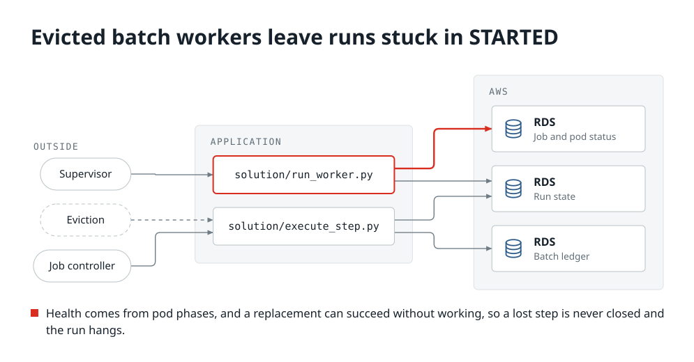

# Evicted batch workers leave runs stuck in STARTED

A nightly batch runner on RDS trusts pod status to judge step health, so a worker lost to eviction hangs the run, and reset connections repeat batches.

## The system
A run worker drives a four-step workflow: extract, then load and audit in parallel, then publish. It submits each step by inserting a Job row, and a controller turns that row into a pod. Each pod runs `execute_step.py`, which records events and commits batches to an append-only ledger. Processes share only RDS: Job and pod tables, events, and the ledger.

## What goes wrong
- After a node eviction, runs stay `STARTED` with partial extract output, a replacement worker that exits successfully, and no downstream load.
- The run timeout is the only way out.
- Connection resets produce repeated batches.
- When a branch fails validation, the run reports `FAILURE` while its peer keeps writing.

## Where the issue is
`check_step_health` in `run_worker.py` reads pod phases, and a Job's replacement pod can succeed without doing any work: `verify_step` sees the earlier start and exits cleanly. Nothing closes the step, and the run waits. The original pod may be Terminating yet still writing.

`commit_batch` in `execute_step.py` replays `write` after any connection error, though a lost response does not show whether it landed. Nothing stops a returning old worker from writing more, and `run_worker.py` reports failure without draining peers.

The right shape is a durable fence per step attempt, checked inside each batch transaction, with heartbeats in database time.

## What a correct fix must do
- Recover a lost extract worker to run success within 60 seconds, without spending retries on a pod status change.
- Treat a Job with no admitted worker after ten seconds as lost, without inventing a start.
- Land each batch exactly once per attempt, keep partial history, and refuse anything from a closed attempt.
- Survive overlapping run worker restarts without resetting ages or budgets.
- On branch failure, cancel peers and close `FAILURE` within 25 seconds.

## How it is graded
Tests provision an RDS instance and run the controller and workers as separate processes. Workers get killed, or suspended with SIGSTOP while sessions are cut, then resumed long after recovery. A relay loses connections around commits, run workers restart, and pods miss admission. Validation failures hit with a peer suspended, pending or mid-commit. Tests then check the ledger and events for duplicates, late writes and missed deadlines.

## Why it is hard
Slow SQL looks like a lost worker, so contact must renew on another session without blocking on the batch transaction. A session lock dies with the connection while its commit may still be running, so a replay must wait for it before checking for a receipt. Cancelling a peer cannot assume its writes stopped.

## Real-world basis
Modelled on a failure publicly reported against an open-source data orchestrator, where step verification left runs stuck after a worker was evicted.

## Task facts

| | |
|---|---|
| Task | `swe-cloud/if-rds-batch-step-duplicate-start-on-recovery` |
| Type | Issue fixing |
| AWS services | RDS |
| Language | Python |
| Runtime | Local AWS-compatible emulator with live service engines. No internet access. |
| Hidden tests | 3 test functions |
| Expert estimate | 4 hours |
| Agent time limit | 1 hour |
| Resources | 4 CPUs, 8 GB memory |
