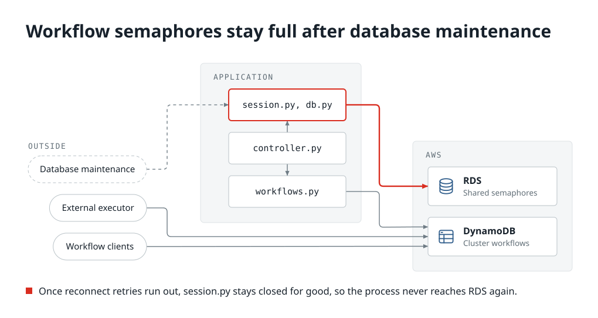

# Workflow semaphores stay full after database maintenance

A workflow controller admits work through RDS semaphores. After a connectivity loss it stays wedged, and rows for ended workflows keep holding capacity.

## The system
Controllers in separate clusters share RDS semaphores: `sync_limit` sets each size, `sync_state` holds one row per waiting or holding workflow, and `sync_controller` records heartbeats. Each cluster keeps its workflows in its own DynamoDB table. A controller commits a slot in a serializable SQL transaction, then updates the workflow to `Running` with `sync_holding`. An external executor runs the work independently, keeps per-node receipts in the same table and sets `exec_done`.

## What goes wrong
- After a database proxy recycle the controller stays up, but waiters pile up.
- A pool that normally runs two jobs runs one at a time for the rest of the shift.
- A `Failed` workflow still counts in SQL.
- A rollout does not clear another pool until someone finds a row for a deleted workflow.

## Where the issue is
`session.py` sets `closed` when it starts reconnecting and clears it only on success. Once the retries run out, every later call raises "session proxy is closed", so the process lives on but never talks to RDS again.

The leak is in `controller.py`. `release_all` trusts `sync_holding`, so a slot committed before the status update is never released. `check_existence` only looks at semaphores remembered in memory, matches rows by reusable name instead of `execution_id`, and frees a slot without asking whether anything is still running.

The right shape keeps retrying, reconciles this controller's own rows against each workflow's `uid`, closes the executor's receipts across the whole node tree, and releases only once nothing runs or can start.

## What a correct fix must do
- Resume heartbeats, admission and release in the same process within 20 seconds of connectivity returning.
- Recover abandoned slots within 20 seconds, including after a restart.
- Keep the slot while any payload of a cancelled or deleted workflow runs, with no fixed grace period.
- Never touch another controller's rows, or inherit a predecessor's slot at a reused name.
- Replacing the SQL tables with another lock does not count.

## How it is graded
One long scenario runs two controllers through proxies against an RDS instance and workflow tables, with a stand-in executor. It plants orphan rows, cuts one controller's database link for 40 seconds, kills another mid-admission, deletes and recreates workflows while they run, and races a child publication against closing the tree. A monitor watches rows, heartbeats and executions for overruns and overlaps.

## Why it is hard
Workflow status and SQL rows live in different stores, so either can be stale at any step. Execution outlives the API object, so an absent workflow proves nothing about running payloads. Closing a tree races with new children, so each node must be closed before reading its children.

## Real-world basis
Modelled on a failure publicly reported against an open-source workflow engine's database-backed semaphores.

## Task facts

| | |
|---|---|
| Task | `swe-cloud/if-rds-dynamodb-workflow-semaphore-capacity-stuck` |
| Type | Issue fixing |
| AWS services | RDS, DynamoDB |
| Language | Python |
| Runtime | Local AWS-compatible emulator with live service engines. No internet access. |
| Hidden tests | 1 test function |
| Expert estimate | 4 hours |
| Agent time limit | 1 hour |
| Resources | 4 CPUs, 8 GB memory |
