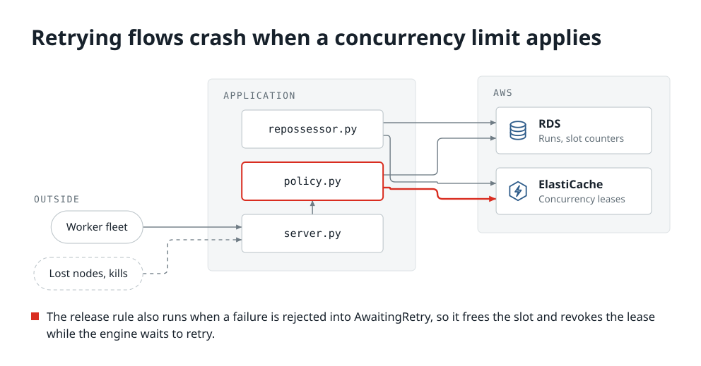

# Retrying flows crash when a concurrency limit applies

A flow orchestrator keeps slot counters in RDS and leases in ElastiCache. A retry gives its slot back while the engine still runs, so the next lease renewal fails and the run ends Crashed.

## The system
Workers run flows through an orchestration server. Every state change goes through `POST /flow_runs/<id>/set_state`, where rules in `policy.py` accept or reject it. Deployments with a limit have a `concurrency_limit_v2` row in RDS, whose `active_slots` counts the runs holding a slot. Each slot comes with a lease in ElastiCache, indexed by expiry, and the lease id travels on the run's states. Engines renew their lease, and `repossessor.py` returns the slots of expired ones.

## What goes wrong
- On limit-1 deployments, flows with `retries` end `Crashed` at `run_count=1` instead of running again.
- The engine log says slots are no longer reserved.
- Short retry delays sometimes get through, and long ones die every time.
- Twice, after a worker node was lost, two runs of a limit-1 deployment executed at once.

## Where the issue is
In `policy.py`, `RetryFailedFlows` rejects a failure into `AwaitingRetry`, a SCHEDULED state. `ReleaseFlowConcurrencySlots` also runs on rejected transitions and sees RUNNING to SCHEDULED, so it decrements the counter and revokes the lease while the engine keeps waiting in-process. The retry state also drops `lease_id`, and later renewals get 410.

The double run comes from the release path. After the repossessor has reclaimed a dead run's slot, a late forced `Crashed` finds the lease gone and decrements anyway, taking a slot another run holds. Counter and lease share no transaction, so a kill between them can repeat or lose a release.

The correct shape keeps the slot through in-process retries, and records each lease's release once, in the same RDS transaction as the decrement.

## What a correct fix must do
- Keep the slot and lease across an in-process retry.
- Release at once when a SIGTERMed supervisor proposes the same `AwaitingRetry` directly.
- Return each slot exactly once across terminal states and expiry.
- Answer 410 to renewals of released leases, leaving no record behind.
- Leave the worker fleet unchanged.

## How it is graded
One workload runs four limit-1 deployments against RDS and ElastiCache on a local AWS-compatible emulator, using the unchanged fleet. One run retries in-process with a long delay. Another's supervisor gets SIGTERM during its second attempt. Others are SIGKILLed and later force-marked `Crashed`, and in one case the server process returning the expired lease is killed mid-release and restarted. Tests check attempt overlaps, sampled `active_slots`, renewal answers, and that nothing is left in either store.

## Why it is hard
A rejected retry and a supervisor's reschedule produce the same state name but need opposite treatment. Two release paths race across two stores, and either process can die between writes, so fixing the crash alone leaves over-allocation.

## Real-world basis
Modelled on a failure publicly reported against an open-source workflow orchestration platform.

## Task facts

| | |
|---|---|
| Task | `swe-cloud/if-rds-elasticache-flow-retries-crash-at-concurrency-cap` |
| Type | Issue fixing |
| AWS services | ElastiCache, RDS |
| Language | Python |
| Runtime | Local AWS-compatible emulator with live service engines. No internet access. |
| Hidden tests | 9 test functions |
| Expert estimate | 4 hours |
| Agent time limit | 1 hour |
| Resources | 4 CPUs, 8 GB memory |
