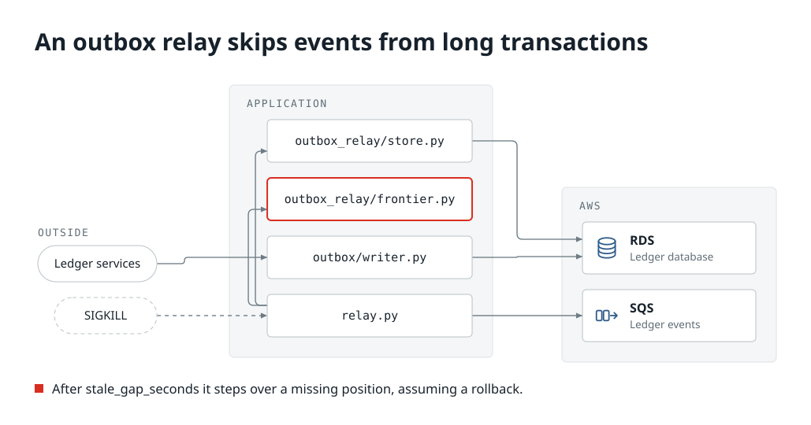

# An outbox relay skips events from long transactions

A relay from an RDS outbox table to an SQS FIFO queue steps over positions it assumes were rolled back, permanently dropping events from transactions that are simply still open.

## The system
Ledger services write events into an `outbox` table in the same RDS transaction as their business change. `relay.py` polls the table and publishes each row to the `ledger-events` FIFO queue on a single message group, strictly in `position` order, because consumers treat a skipped position as "never happened". Progress lives in `relay_checkpoint`. Positions come from a sequence, so they are drawn before commit and rows become visible out of order.

## What goes wrong
- Month-end close finds events in `outbox` that never reached the queue.
- Most are `ReconciliationStarted` events, from transactions held open a minute or more. Others are scattered through the busiest hours.
- Before the timeout existed, the relay once froze for 41 minutes behind a rolled-back write.

## Where the issue is
`outbox_relay/frontier.py` holds at the first missing position, then steps over it after `stale_gap_seconds` (10 seconds). A timeout cannot tell a dead hole from a slow writer, so a slow transaction's event is passed for good.

The right shape replaces time with evidence. Producers take a transaction id before inserting. When the relay sees a hole, it takes a fresh id, which is above every writer that could have drawn that position. Once a later snapshot's oldest active transaction is above that id, any position still missing below the highest visible row is dead.

## What a correct fix must do
- Never pass a position whose transaction is still going to commit, however long it stays open.
- Resume within 20 seconds after a rollback or a dropped duplicate insert, even across repeated SIGKILLs.
- Keep position order, the message format, the checkpoint's meaning and 5 second delivery, and let lag return to zero.
- Leave `db/` and `outbox/` alone. A longer timeout does not count.

## How it is graded
The tests run the real relay against their own RDS instance and FIFO queue, with four background writers. The relay is SIGKILLed at four scheduled moments. A write rolls back, a duplicate insert is dropped, and a reconciliation transaction stays open for 45 seconds. Two pairs of writers invert order, so the lower position has the higher transaction id. A leader-election session idles in a transaction throughout. The tests compare everything received with the committed rows, and check order and the checkpoint at set times.

## Why it is hard
Each simple answer fails one side. Timeouts lose slow writers. Checking for open transactions freezes on the always-open scheduler session. Transaction ids do not follow position order. The proof must also hold across restarts.

## Real-world basis
Modelled on a publicly described ordering problem with sequence-based outbox tables, covered in a technical article and in an open-source event store's design.

## Task facts

| | |
|---|---|
| Task | `swe-cloud/if-rds-sqs-outbox-relay-skips-long-transaction-events` |
| Type | Issue fixing |
| AWS services | RDS, SQS |
| Language | Python |
| Runtime | Local AWS-compatible emulator with live service engines. No internet access. |
| Hidden tests | 9 test functions |
| Expert estimate | 4 hours |
| Agent time limit | 1 hour |
| Resources | 4 CPUs, 8 GB memory |
