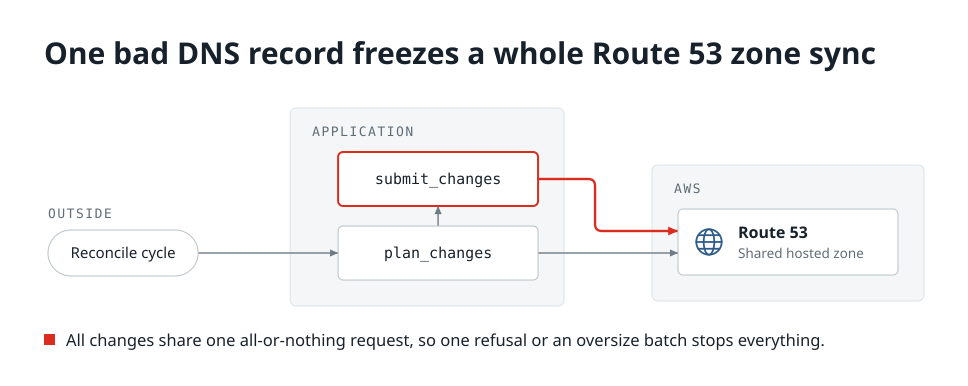

# One bad DNS record freezes a whole Route 53 zone sync

A reconciler syncs a shared Route 53 zone with one all-or-nothing change batch, so any refused or oversized change blocks every other name, and its report miscounts.

## The system
`reconciler.py` is a one-shot tool that keeps `example.test.` in line with a desired endpoint list. Each cycle lists the zone, plans changes and calls `ChangeResourceRecordSets` through an operator relay that refuses more than 8 changes per request. Ownership lives in the zone: `svc-07.example.test.` is claimed by the TXT record `a-svc-07.example.test.`, whose labels name an owner. Another controller, `cluster-b`, shares the zone, and other writers briefly occupy names.

## What goes wrong
- A cycle against a zone that was well behind sent 32 changes, got `InvalidChangeBatch`, and nothing landed, on every cycle. Stale addresses keep serving.
- An A record deleted by hand never returned. Each cycle fails because `a-svc-07` "already exists".
- The report names a failure once and then forgets it. `svc-11` came back failed on Monday and was never mentioned again, though still wrong.

## Where the issue is
Route 53 applies one request as a unit, and `submit_changes` puts every change into one request. So one oversized batch or refused change stops every endpoint.

`plan_changes` re-creates the claim whenever the A record is missing, even when the claim is still there, and that `CREATE` can never commit. It tries the same on names another owner has claimed. Deletes state the claim with the record's TTL instead of the stored one. The report only covers changes tried this cycle, not the desired list.

## What a correct fix must do
- Keep each record and its claim in one request, and retry a refused batch name by name. Splitting them to fit the limit does not count.
- Restore a missing record under its surviving claim, untouched byte for byte.
- Never write names claimed by others, or served without a claim we can parse.
- Delete retired pairs using the stored claim.
- Converge what can within two cycles, and report every desired endpoint as `applied` or `failed`.

## How it is graded
The tests build a zone with a stale record, a claim with no record, another owner's claim, a foreign unclaimed record and a retired pair. They run three cycles as separate processes through a relay that logs each request and acts as other writers, occupying three names at the moment of the reconciler's own write: one once, two on every attempt. They read the zone after cycles two and three, check exact contents, and inspect each accepted request for claims split from records.

## Why it is hard
The request is both the safety boundary and the blast radius. Splitting to fix the freeze breaks pairing, and rewriting claims to fix the restore can take someone else's name. The workable unit is one name's pair.

## Real-world basis
Modelled on a failure publicly reported against an open-source DNS controller's Route 53 provider.

## Task facts

| | |
|---|---|
| Task | `swe-cloud/if-route53-zone-sync-stuck-on-failing-record` |
| Type | Issue fixing |
| AWS services | Route 53 |
| Language | Python |
| Runtime | Local AWS-compatible emulator. No internet access. |
| Hidden tests | 7 test functions |
| Expert estimate | 4 hours |
| Agent time limit | 1 hour |
| Resources | 2 CPUs, 3 GB memory |
