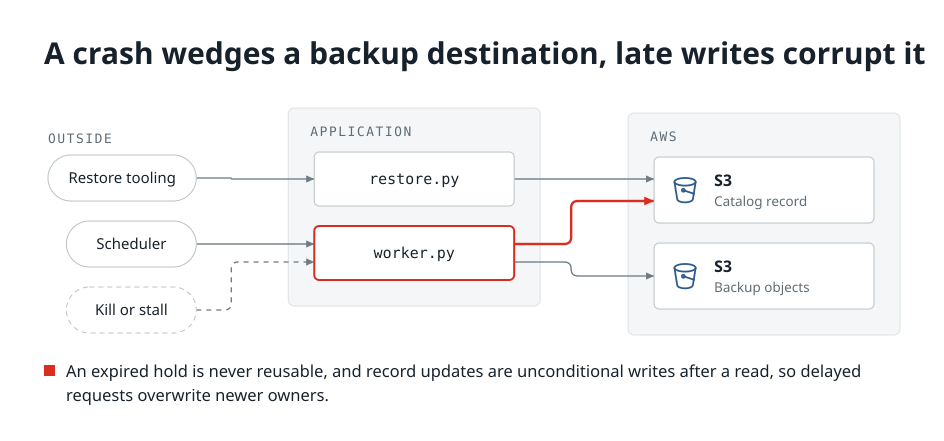

# A crash wedges a backup destination, late writes corrupt it

A backup worker coordinates through one S3 record. A killed worker blocks the destination for good, and delayed writes from failed runs can replace another run's reservation, publication or files.

## The system
A scheduled Python worker copies a directory snapshot into S3. Each destination has one permanent JSON record at `<prefix>/.lock` saying who holds it, until when, and which manifest is published. `worker.py` reserves that record, refreshes the lease in a background thread, uploads files under `data/`, writes a manifest and marks the record `committed`. `restore.py` follows `manifest_key` and verifies every object.

## What goes wrong
- After a worker is killed, every retry reports `BACKUP_ALREADY_EXISTS`, though nothing was published and the lease ran out long ago.
- After a storage interruption, a run reports `BACKUP_CREATED`, yet the destination restores a different run's files.

## Where the issue is
In `worker.py`, `open()` only accepts a record in state `free`, so a `held` record past its `expires_at_ms` can never be reused. Every record update is a plain `PutObject` after a separate read, so a delayed request can overwrite a newer owner's reservation or even a publication. Ownership checks ignore the epoch and expiry time. Data goes to shared keys, `data/<name>`, so a failed run's late upload can replace bytes a published manifest points at.

The correct shape is compare-and-swap on the record, using `If-Match` with the ETag just read, plus data keys that belong to one attempt.

## What a correct fix must do
- Reuse an unfinished reservation once it has expired, and never sooner.
- Keep a healthy owner in place through many lease intervals, reserving the full lease on each refresh.
- Stop stale workers from undoing newer state or changing published bytes.
- Report `BACKUP_CREATED` when the publish applied but its response was lost.
- Keep the record present. Deleting it, local files or another coordination service do not count.

## How it is graded
Each worker reaches S3 through a test-owned HTTP relay that logs every request. The relay pauses a worker's publish, upload or claim while a replacement runs, then releases the old request. Other cases SIGKILL a worker and require a retry to publish within one lease plus 6 seconds, run a paced upload for more than two leases against repeated rivals, close the connection after an applied write, and start two workers at once. The tests then compare published bytes with the winner's source and replay the record's history: one winner, no early takeover, correct lease durations, publication never replaced.

## Why it is hard
Takeover after expiry makes stale writers dangerous, so writes must be conditional. Conditional writes make a lost response ambiguous, so the worker must read back and recognise its own write, which needs a distinct identity on each transition. None of this protects data objects, so their keys have to change too.

## Real-world basis
Modelled on failures publicly reported against an open-source database's backup-to-S3 feature.

## Task facts

| | |
|---|---|
| Task | `swe-cloud/if-s3-backup-destination-wedged-by-crash` |
| Type | Issue fixing |
| AWS services | S3 |
| Language | Python |
| Runtime | Local AWS-compatible emulator. No internet access. |
| Hidden tests | 6 test functions |
| Expert estimate | 4 hours |
| Agent time limit | 1 hour |
| Resources | 2 CPUs, 3 GB memory |
