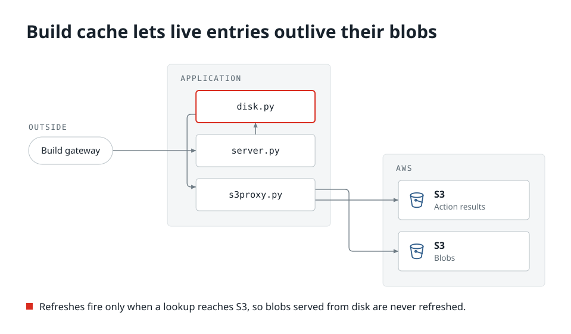

# Build cache lets live entries outlive their blobs

A build cache refreshes S3 blobs only when a lookup reaches S3. Hot blobs served from disk age out, and lifecycle deletes them under live cache entries.

## The system
`cachesvc` is a Python build cache: two replicas with private disks, sharing one S3 bucket. Action results live under `ac/`, blobs under `cas.v2/`. Lifecycle rules, which only delete, expire each prefix by `LastModified`: in staging, `ac/` at 20 seconds and `cas.v2/` at 40. Clients trust that an entry's outputs exist. `CAS_REFRESH_AGE` is meant to protect that, by copying a blob onto itself in the background once it is 7 seconds old.

## What goes wrong
- Builds fail several times an hour with `Lost inputs no longer available remotely`.
- Each failure follows a hit from r2 on an entry recently written through r1.
- The output was already gone from `cas.v2/`, while its entry remained in `ac/`.
- One such blob is a core library nearly every build on r1 produces.

## Where the issue is
`disk.py` answers lookups from local disk, and `s3proxy.py` only queues a refresh when `contains()` or `get()` reaches S3. So a blob hit constantly on disk is never refreshed, its S3 copy keeps ageing, and a new entry can reference it near expiry. The ordering argument in `docs/cas_refresh_age.md` fails for exactly the hottest blobs.

The right shape has disk hits notify the proxy, which tracks each blob's S3 age and refreshes in the background.

## What a correct fix must do
- Never leave an `ac/` entry whose output is gone.
- Keep disk-hit lookups off S3: under 250 ms, with about one S3 request per refresh period.
- Issue one copy per blob, retry after `SlowDown`, and not assume a failed copy worked.
- Relearn ages after a restart, since memory is lost and disk is not.
- Never refresh or rewrite `ac/` entries. Inline copies, deletes and lifecycle changes do not count.
- Let unused blobs expire.

## How it is graded
One run starts two real replicas against a local emulator through a test proxy that adds latency, answers some copies with `SlowDown` and logs every request. A janitor applies lifecycle each second, and a scanner records every object's history. A client hammers one hot blob on r1, writes entries for it, restarts r1, and reads entries through r2. The tests look for dangling entries, output age when each entry was written, false "missing" answers, latency, request and copy counts, moved `ac/` timestamps, and abandoned objects.

## Why it is hard
One timestamp controls both reclamation and safety. Refreshing on every hit breaks cost, and refreshing too little breaks safety. A disk hit carries no age, so age must be learned without waiting on S3. r2 sees a blob only rarely, while r1 keeps it alive, and r2's answers must stay truthful.

## Real-world basis
Modelled on an issue and pull request against an open-source remote build cache's S3 lifecycle support.

## Task facts

| | |
|---|---|
| Task | `swe-cloud/if-s3-build-cache-referenced-blobs-expire` |
| Type | Issue fixing |
| AWS services | S3 |
| Language | Python |
| Runtime | Local AWS-compatible emulator. No internet access. |
| Hidden tests | 11 test functions |
| Expert estimate | 4 hours |
| Agent time limit | 1 hour |
| Resources | 2 CPUs, 3 GB memory |
