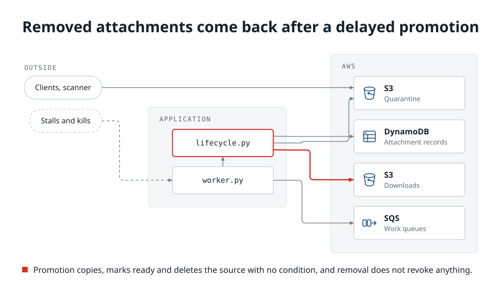

# Removed attachments come back after a delayed promotion

An attachment service copies clean files from quarantine to downloads with no fencing, so a stalled scan worker can republish a file after the user's removal was acknowledged.

## The system
Clients upload attachments to an S3 quarantine bucket with a presigned URL. A scanner sends its verdict to an SQS queue, and promotion workers copy clean files to the download bucket. A DynamoDB table holds each attachment's `state` (`pending`, `ready`, `deleting`) and expiry, with a `PendingExpiry` index for the `cleanup` sweep. User removals arrive on a second queue, and a delete worker announces each finished one on an events queue. Queues deliver at least once.

## What goes wrong
- An attachment discarded from an account becomes downloadable again after the UI acknowledged removal, especially with a high scan backlog.
- Clean uploads remain in staging after a worker restart.

## Where the issue is
`lifecycle.py` treats promotion as three independent steps. `promote` runs `CopyObject`, then an unconditional `UpdateItem` to `ready`, then deletes the source. `remove` deletes the download and the row. So a promotion paused before its copy lands, or a late upload followed by a duplicate verdict, publishes after removal. The `UpdateItem` also recreates the deleted row, since it has no condition. `cleanup` removes anything the index returns, even a stale view of a wanted file.

The right shape makes publication revocable. Register a multipart upload's `uploadId` on the row, so removal can mark `deleting` and abort it. A delayed `CompleteMultipartUpload` then fails with `NoSuchUpload`. State changes become conditional writes.

## What a correct fix must do
- Keep a removed attachment removed, even when a stalled promotion or delayed upload arrives later.
- Finish removal within 15 seconds of visibility without waiting for a paused worker, and announce it only once finished.
- Keep unfinished cancellation discoverable, with its `uploadId`, for retries and the sweep.
- Resume a committed or partial transfer after a crash, never opening a second one or overwriting a download.
- Let `cleanup` finish cancellations, reconcile interrupted publications and spare wanted files.

## How it is graded
Each test sends workers through a relay that logs every request and can stall a publication, withhold a committed response, or fail an abort. Workers are killed at those points, alongside duplicate verdicts, late uploads and stale index pages. Tests then check that nothing reappears, including while a response is held, that delayed completions fail with `NoSuchUpload`, that only one transfer was opened, and that no unfinished uploads remain.

## Why it is hard
`CopyObject` cannot be cancelled, and a delete cannot stop one already in flight. Any lost reply might mean success, so every step must be resumable by a new consumer. Removal cannot wait for the paused worker, and an abort that fails must leave enough on the row to retry.

## Real-world basis
Modelled on a failure publicly reported against an open-source platform's attachment handling, where a delete raced antivirus promotion.

## Task facts

| | |
|---|---|
| Task | `swe-cloud/if-s3-dynamodb-attachment-delete-vs-scan-promotion` |
| Type | Issue fixing |
| AWS services | SQS, S3, DynamoDB |
| Language | Python |
| Runtime | Local AWS-compatible emulator. No internet access. |
| Hidden tests | 9 test functions |
| Expert estimate | 4 hours |
| Agent time limit | 1 hour |
| Resources | 2 CPUs, 3 GB memory |
