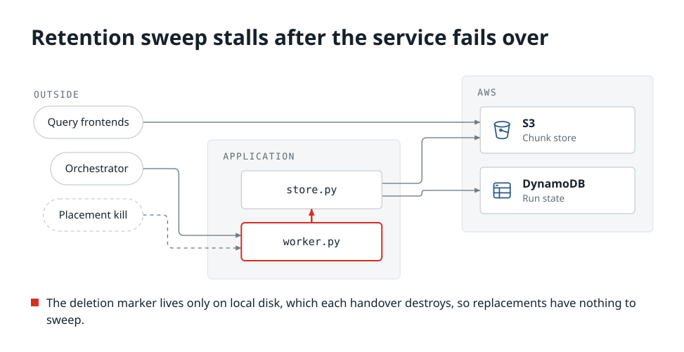

# Retention sweep stalls after the service fails over

A chunk store's retention job keeps pending deletions on local disk. Replacements lose them, so expired S3 objects stay, and the obvious fix deletes chunks that queries still read.

## The system
A chunk store keeps log chunks and immutable index snapshots in one S3 bucket, with a DynamoDB table holding per-run state. `worker.py` runs retention in two phases. It writes a snapshot without the expired chunks, records a deletion batch, then flips `HEAD` and the batch state in one conditional transaction. Then, after the run's 8 second grace, it deletes the chunks. Query frontends may keep serving the previous snapshot for 6 seconds after a flip, and a running query may read for 1 more. An orchestrator replaces placements without warning, each with a fresh work directory.

## What goes wrong
After a failover drill with three forced handovers:
- The batch record sits short of `DONE`.
- Two chunks the live index no longer references stay in the bucket.
- The index and its queries are fine.

An earlier build failed the opposite way: queries got not-found for entries the serving tier still resolved.

## Where the issue is
`_write_marker` in `worker.py` keeps the deletion marker, including sweep progress, under the local `--work-dir`. The predecessor's disk is destroyed, so `sweep_pending` in a replacement finds no markers and the batch stays `PUBLISHED`. Nothing ever writes the audit record under `markers/` in S3, as the service's documentation requires.

The grace is the second half. `_eligible` counts from the marker's `created_at`, which predates publication. Share that marker as it stands, and a replacement sweeps at once, while frontends still serve the old snapshot. The other tables of the tenant also keep their own `HEAD#<table>` pointers, and those snapshots can still list a chunk.

## What a correct fix must do
- Delete every marked chunk and reach `DONE` within the budget of 36 seconds after publication, across repeated kills.
- Honour the grace from publication, and from the last time any table stopped serving the chunk.
- Keep retained chunks, staged uploads, old snapshots and the marker intact.
- Shortening the grace, or restarting it for each placement, does not count.

## How it is graded
One scripted run uses the existing pause points to hold the batch before publication, then SIGKILLs a placement after publication, after its first delete and again during the grace on the last chunk. A second table turns its snapshots over mid-run, including one that lists a chunk again. Three query frontends read throughout and record failures. The tests check deletion times, progress at each kill, completion time and object digests.

## Why it is hard
Finishing and waiting pull against each other. The anchor must be durable, or each replacement restarts the clock and misses the budget. Yet it must also move forward when another table releases a chunk late.

## Real-world basis
Based on the published retention design of an open-source log store, not a single bug report.

## Task facts

| | |
|---|---|
| Task | `swe-cloud/if-s3-dynamodb-chunk-retention-across-failover` |
| Type | Issue fixing |
| AWS services | DynamoDB, S3 |
| Language | Python |
| Runtime | Local AWS-compatible emulator. No internet access. |
| Hidden tests | 8 test functions |
| Expert estimate | 4 hours |
| Agent time limit | 1 hour |
| Resources | 2 CPUs, 3 GB memory |
