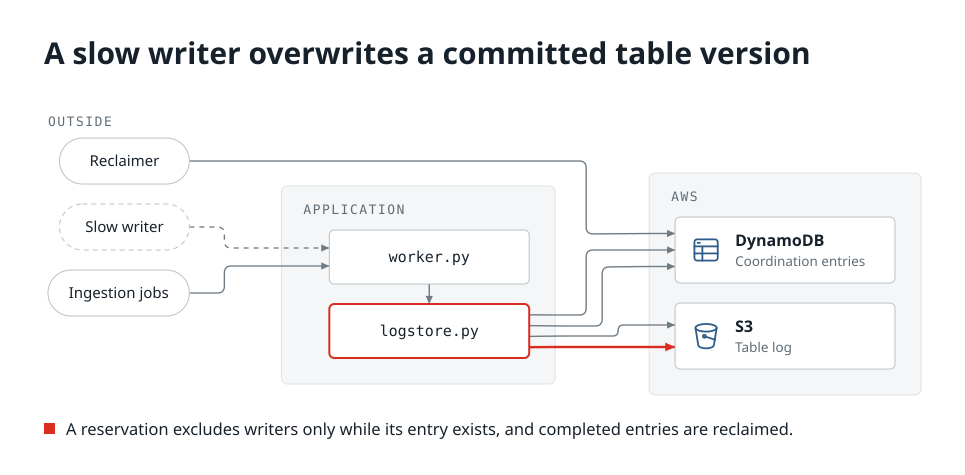

# A slow writer overwrites a committed table version

A table's commit log lives in S3 with short-lived DynamoDB entries for coordination. Once an entry is reclaimed, a slow writer can claim the same version again and replace its committed bytes.

## The system
Ingestion jobs commit numbered versions of a table to S3, as objects like `log/00000000000000000001.json`. S3 alone gives them no mutual exclusion here, so `logstore.py` coordinates each version through an entry in the DynamoDB table `log_coord`. A writer puts its actions in a temp object, reserves the version with a conditional `PutItem`, copies the temp object onto the log object, then marks the entry complete with an expiry 2 seconds later. A separate reclaimer deletes expired entries. Incomplete entries stay, so others can finish a dead writer's publication.

## What goes wrong
- Two jobs both captured the table at version 0.
- Version 1 committed at 14:06 and version 2 at 14:16, and downstream jobs consumed version 1.
- At 15:29 the slower job wrote version 1 again. The original actions are gone.
- Every writer believed it had committed, with no errors.

## Where the issue is
In `logstore.py`, `write()` treats the reservation as proof that the version is free. But the reservation only excludes writers while the entry exists, and completed entries are meant to disappear. After that the conditional `PutItem` succeeds, and the copy onto the log object is an unconditional `PutObject`. The same method also catches any exception and still answers `committed`.

The only durable evidence of a past commit is the log object. The correct shape checks for that object after holding the claim, reports `conflict` if it exists, and settles the losing claim.

## What a correct fix must do
- Keep an acknowledged version's bytes unchanged for the life of the table.
- Tell a losing writer `conflict` within seconds, and only say `committed` when it is true.
- Keep expiry on completed entries only. Making entries permanent does not count.
- Let readers or the next writer finish a dead writer's publication.
- Not delay or serialize writers.

## How it is graded
The tests run real worker processes against S3 and DynamoDB on a local AWS-compatible emulator, with a reclaimer running throughout. Workers announce steps on an operations socket, so tests can hold one at an exact point: they park a writer before its commit or just before its reservation, commit two versions past it, wait for the entries to be reclaimed, then release it and read the objects back. Other cases resume a writer before and after reclaim, remove a recorded temp object, and overtake one at its probe.

## Why it is hard
The object check must not call a writer's own recovered publication a conflict, so the entry has to say whose publication finished. A loser must also complete its own claim, or the table never empties.

## Real-world basis
Modelled on a failure publicly reported against an open-source table format's S3 log store.

## Task facts

| | |
|---|---|
| Task | `swe-cloud/if-s3-dynamodb-commit-log-version-overwritten` |
| Type | Issue fixing |
| AWS services | DynamoDB, S3 |
| Language | Python |
| Runtime | Local AWS-compatible emulator. No internet access. |
| Hidden tests | 10 test functions |
| Expert estimate | 4 hours |
| Agent time limit | 1 hour |
| Resources | 2 CPUs, 3 GB memory |
