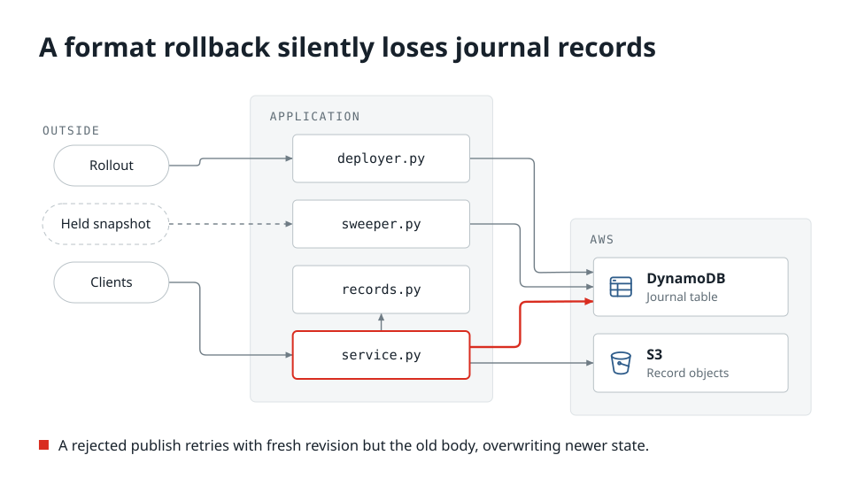

# A format rollback silently loses journal records

An object journal on S3 and DynamoDB migrates its record format while serving. Mixed builds, a rollback and a backfill silently lose counters and attributes.

## The system
The journal stores each record as one immutable object in S3, and a DynamoDB `HEAD#<rid>` item names the current object and revision. Three slots serve reads and updates, and each update writes a new object, then moves the head in a transaction guarded by revision and control epoch. The format is moving from XML to JSON in steps: `v1` reads and writes XML, `v2` reads both and writes XML, `v3` writes JSON and adds `set_attr`. `deployer.py` moves the fleet between phases through a `CTRL` item, and `sweeper.py` backfills old records into JSON while slots keep serving.

## What goes wrong
Every request returns success throughout, and no slot reports an error. Afterwards:
- The reconciliation job finds counters behind what the ledger acknowledges on records live during the rollback window.
- Fields written by `set_attr` and attributes from the original load are missing.
A straight rollout on a quiet journal reports clean.

## Where the issue is
In `service.py` and `sweeper.py`, when a publish is rejected the retry refreshes revision and epoch but publishes the body it already built, so it overwrites whatever moved the head. The conditional write passes because it now names the current revision. In `records.py`, decoding throws away every attribute except `counter`, so any rewrite drops them. In `deployer.py`, `activate` needs only a majority of slots to read both formats, so a `v1` slot can meet JSON it cannot decode.

The right shape recomputes from a fresh read on every attempt, carries attributes through unchanged, and requires every registered slot to read both formats.

## What a correct fix must do
- Keep every acknowledged update and every attribute, whatever mix of builds, rollback or backfill is running.
- Refuse `activate` while an XML-only slot is registered.
- Reconvert from the current record when a held backfill snapshot is released late, and announce each new snapshot.
- Keep serving during convergence, and migrate every record.

## How it is graded
Over three repetitions the tests launch and replace real slot processes, drive prepare, activate, rollback and re-roll under traffic, and keep their own model of every acknowledged operation. They hold the backfill at a snapshot, change the record, roll back, then release it. They also send concurrent bursts at one record and try to activate with an XML-only slot. They parse the actual S3 objects and table items, then compare counters, attributes, receipts and decoding on each build.

## Why it is hard
Fixing the codec alone leaves stale retries reverting state. Fixing retries alone still drops attributes on each older-build rewrite. The revision check looks like it protects everything, but it only protects a body built from that revision.

## Real-world basis
Modelled on a public engineering article about rollback safety in two-phase deployments, not a bug report.

## Task facts

| | |
|---|---|
| Task | `swe-cloud/if-s3-dynamodb-journal-loses-records-on-rollback` |
| Type | Issue fixing |
| AWS services | S3, DynamoDB |
| Language | Python |
| Runtime | Local AWS-compatible emulator. No internet access. |
| Hidden tests | 14 test functions |
| Expert estimate | 4 hours |
| Agent time limit | 1 hour |
| Resources | 2 CPUs, 3 GB memory |
