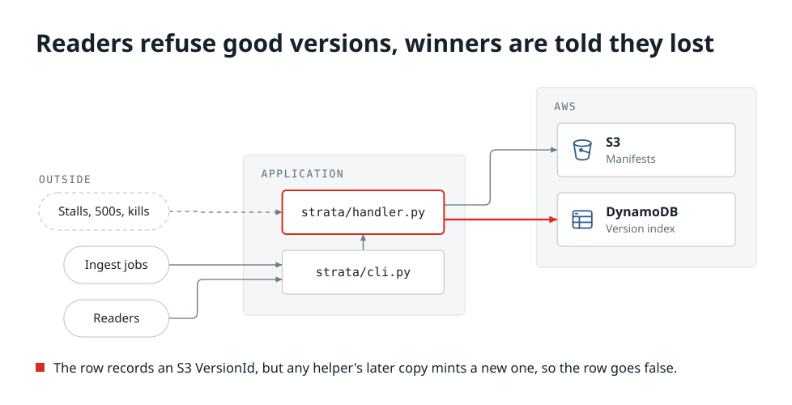

# Readers refuse good versions, and winners are told they lost

A manifest store records an S3 VersionId in DynamoDB, but any helper's later copy replaces that object, so readers refuse intact versions. A failed index update also reports a won commit as a conflict.

## The system
`strata` stores dataset manifests in a versioned S3 bucket and coordinates writers through one DynamoDB row per dataset version. `stratactl commit` stages `N.manifest-<uuid>`, reserves the version with a conditional `PutItem`, copies staging to `N.manifest`, then points the row there and deletes staging. Committers can die, so any reader that finds a pending row finishes those steps itself. `stratactl resolve` checks a finalized row against a `HeadObject` of the canonical key.

## What goes wrong
- Dashboards intermittently fail right after a commit, with exit 2 and `Manifest generation mismatch`. Most clear quickly.
- `warehouse/orders` v41 never cleared. Its bytes are intact, and both object versions are identical.
- `nightly-merge` got `conflict` for `warehouse/events` v12, re-planned and committed the same batch as v13, doubling row counts.
- `stream-ingest` landed a batch twice on `warehouse/sessions` v7 the same way.

## Where the issue is
In `strata/handler.py`, finalizing writes the VersionId from its `HeadObject` into the row's `generation`. Each `CopyObject` to a versioned key creates a new VersionId, and copy, head and publish are separate steps, so another helper's copy can land after the row is written. Then the row is false, and `verify_finalized_location` refuses the version. For v41 the row stays wrong forever.

Separately, `commit` turns any exception, including a 500 on the final `PutItem`, into `CommitConflict`, even after its own manifest was copied into place.

## What a correct fix must do
- Stop putting a generation in rows, and ignore those already stored, so v41 opens.
- Still refuse a canonical object that is not the selected manifest, and keep returning the generation this process observed.
- Report `committed` when a failed publish follows a successful copy.
- Let a rerun of a killed commit recognise its own manifest, while a different same-size manifest under the same job gets `conflict`.
- Avoid `If-None-Match` and copy preconditions, which the gateway rejects.

## How it is graded
Every process goes through its own fault proxy, which can hold a request, drop it or answer 500. Tests stall a committer's publish and copy while a reader helps, let a late copy land after the publish, SIGKILL committers mid-commit and rerun them, and overwrite the canonical object with different-sized bytes. A shipped 0.14 reader runs too. Row truth and exit codes are checked throughout.

## Why it is hard
A conditional publish cannot help, because the copy lands later. Older readers still verify whatever the row says, so the row must stay true at every instant. Once rows carry less, deciding who won needs the selected bytes themselves, since 0.14 helpers replace the whole item and delete staging.

## Real-world basis
Modelled on a failure publicly addressed in an open-source columnar dataset format's external manifest store.

## Task facts

| | |
|---|---|
| Task | `swe-cloud/if-s3-dynamodb-manifest-index-names-stale-object` |
| Type | Issue fixing |
| AWS services | S3, DynamoDB |
| Language | Python |
| Runtime | Local AWS-compatible emulator. No internet access. |
| Hidden tests | 10 test functions |
| Expert estimate | 4 hours |
| Agent time limit | 1 hour |
| Resources | 2 CPUs, 3 GB memory |
