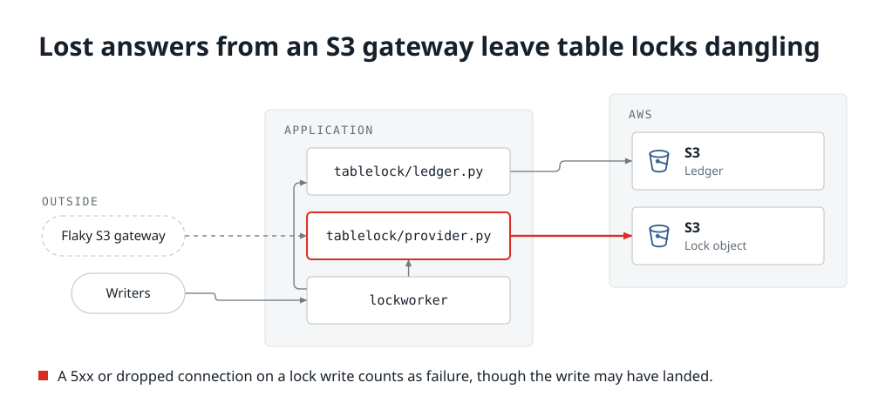

# Lost answers from an S3 gateway leave table locks dangling

Writers serialize commits with one S3 lock object and If-Match. A gateway that loses answers to writes that landed makes them stall the table, misreport releases and risk the ledger.

## The system
Writers commit to an `orders` lakehouse table one at a time, holding a lease in a single S3 object, `orders/_locks/table_lock.json`. Every lock write is a `PutObject` with `If-Match` on the last ETag. Under the lock, a commit reads `orders/ledger/counter.json`, adds an entry and writes the next number. A compaction sidecar locks under the same owner name as the ingest job. All traffic crosses an S3 gateway that sheds load.

## What goes wrong
- The dangling-lock alert pages repeatedly, each page stalling all writers for up to a lease.
- One writer got a `503` for an acquire that landed, then sat behind its own fresh lease until it lapsed.
- One gave up releasing after one failed try.
- One reported `FAILED_TO_RELEASE` for a release that had landed.

## Where the issue is
`tablelock/provider.py` treats a `5xx` or dropped connection on a lock write as failure, though the write may have reached storage. `try_lock` then reads its own lease as someone else's, and `_try_expire` gives up after one ambiguous answer. The lock body only names `owner`, shared with the sidecar, and lease ends are whole seconds, so nothing identifies one acquisition. `tablelock/ledger.py` writes the counter unconditionally, so a request answered `504` and applied seconds later can undo a later holder's commit. A correct approach retries the identical conditional write and recognises its own write by a per-acquisition id.

## What a correct fix must do
- Proceed with an acquire that landed, and report a landed release as released, without waiting out the lease.
- Keep retrying a release that really was refused.
- Never adopt, renew or expire a lease another writer holds, even with the same owner and `validUntil`.
- Land each commit exactly once, including after late `504` writes.
- Keep the lock contract. Weakening the lease does not count.

## How it is graded
`lockworker` processes reach S3 through a test-owned gateway that logs every lock version. It applies writes and loses the answers, refuses writes, and lets a same-owner sidecar take a lease with the worker's own lease end. It also holds a counter write answered `504` until the counter has moved. The tests replay the lock history and ledger for overlap, dangling locks, broken sequences, a counter moving backwards and leases taken from the sidecar.

## Why it is hard
Read-back alone cannot tell two writers apart when owner and lease end match, so the body needs a new identity. The lease does not protect the counter from a write delivered after release, and making that write conditional means the worker's own landed write can return `412`, which also needs reconciling.

## Real-world basis
Modelled on a failure publicly fixed in an open-source lakehouse table format's S3 lock.

## Task facts

| | |
|---|---|
| Task | `swe-cloud/if-s3-lock-dangling-on-ambiguous-responses` |
| Type | Issue fixing |
| AWS services | S3 |
| Language | Python |
| Runtime | Local AWS-compatible emulator. No internet access. |
| Hidden tests | 20 test functions |
| Expert estimate | 4 hours |
| Agent time limit | 1 hour |
| Resources | 2 CPUs, 3 GB memory |
