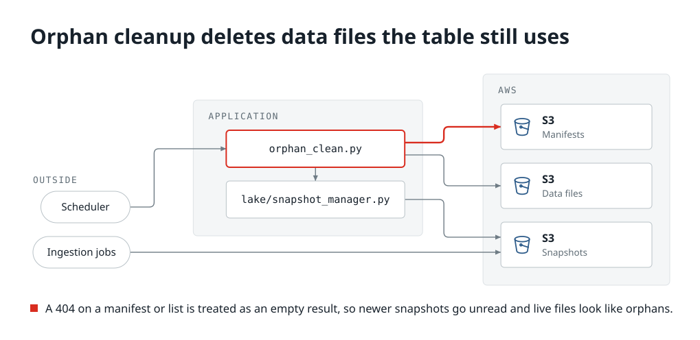

# Orphan cleanup deletes data files the table still uses

A nightly S3 table cleaner treats any missing manifest as a harmless expiry, so a concurrent expiry can shrink its in-use set and it deletes files that retained snapshots still need.

## The system
A data lake table lives entirely in S3. Each snapshot is a JSON object naming manifest lists, which name manifests, which name data files. Ingestion jobs keep committing new snapshots and expiring old ones, deleting one object at a time. Failed commits leave orphan files nobody references, and a nightly `orphan_clean.py` removes them: it lists old files under `bucket-0/` and `manifest/`, collects what every retained snapshot uses, and deletes the difference.

## What goes wrong
- The nightly run on `events_raw` reported `CLEANED`, and minutes later the latest reader and a time-travel reader failed with `NoSuchKey` on data files.
- An earlier build aborted whenever the table changed, which meant every night. Orphans piled up, and it was reverted.

## Where the issue is
In `orphan_clean.py`, `retry_reading_files` turns a 404 on a manifest or manifest list into an empty result. It assumes a concurrent expiry removed the file. But if expiry removes the snapshots a run just listed, their reads return nothing and the run never looks at the newer snapshots, so live files look like orphans. A file truly lost under a retained snapshot gets the same silent treatment.

The table format gives the way out: a snapshot is retained exactly while `snapshot-<id>` exists, and expiry removes that object within 2 seconds of its first delete. So a 404 is explained only if that snapshot file disappears within the bound.

## What a correct fix must do
- Never delete a file a retained snapshot uses.
- Delete nothing and exit 3 with `ABORTED_INCOMPLETE` when a retained snapshot's file is really missing.
- Exit 0 within 60 seconds and remove every old orphan, even while commits and expiry continue.
- Keep the command line and output. Waiting for a quiet table or changing `lake/commit.py` and `lake/expire.py` does not count.

## How it is graded
The cleaner runs as its own process against a gateway that refuses writes and checks each delete as it is forwarded. It can hold a cleaner request while commits and expiry land. Cases cover a quiet table, expiry between listing and reading, merged manifests, files lost under a retained snapshot both with and without new commits, constant churn and an empty table. Tests then walk every remaining snapshot and check orphans and exit codes.

## Why it is hard
A 404 has two meanings that look identical at first. An immediate re-check cannot separate them, because expiry may still be mid-way. A newer clean snapshot proves nothing either, since old retained snapshots still need their files. Chasing the newest view can also overrun the limit.

## Real-world basis
Modelled on a failure publicly reported against an open-source data lake table format, where orphan cleanup read a snapshot being expired.

## Task facts

| | |
|---|---|
| Task | `swe-cloud/if-s3-orphan-cleaner-vs-snapshot-expiry` |
| Type | Issue fixing |
| AWS services | S3 |
| Language | Python |
| Runtime | Local AWS-compatible emulator. No internet access. |
| Hidden tests | 1 test function |
| Expert estimate | 4 hours |
| Agent time limit | 1 hour |
| Resources | 2 CPUs, 3 GB memory |
