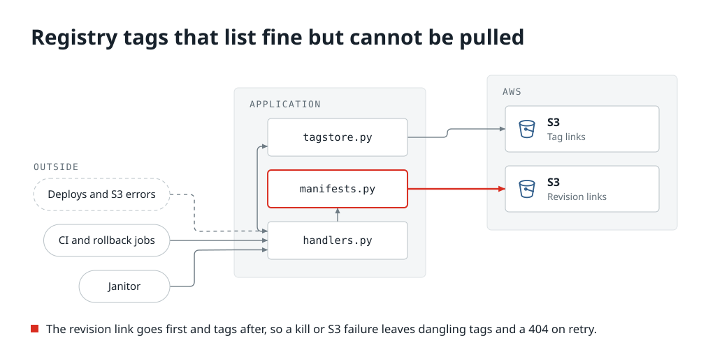

# Registry tags that list fine but cannot be pulled

A container registry on S3 deletes a manifest's revision link before its tags. A crash, S3 error or concurrent push leaves dangling tags, and retries answer 404.

## The system
This is an in-house container registry: two stateless replicas sharing one S3 bucket and nothing else. Manifest bytes live in content-addressed blobs. Each digest has a revision link, and each tag has a `current/link` plus an index of digests. CI pushes builds, promotion and rollback jobs re-tag old digests, and a cron janitor deletes expired digests, retrying every 2 seconds and reading `404` as "already gone". A garbage collector and a nightly audit read the same keys directly.

## What goes wrong
- About 300 tags show in `tags/list` but answer `404 MANIFEST_UNKNOWN` on pull.
- The nightly audit flags every one as broken.
- Deleting those digests again answers `404`, so the janitor cannot clean them up.
- One delete logged a connection reset then `404`, another `202 Accepted`. Both digests still have tags.

## Where the issue is
`delete_manifest` in `handlers.py` removes the revision link first, through `ManifestStore.delete`, then scans for tags and removes them. A replica killed in between leaves tags with no revision, and the retry hits `404`. Failed tag removals are only logged, and the handler still answers `202`. Separately, the tag scan is a snapshot, so a push on the other replica that writes `current/link` afterwards survives the delete.

Reordering fixes the retry but opens the race. The right shape makes the revision link carry state through `If-Match` writes: "delete in progress", then "deleted", both of which other tools already read as absent. Pushes check it again after writing the tag.

## What a correct fix must do
- Answer `202` only when the manifest and every tag on it are gone.
- Leave any interrupted delete in a state the janitor's retries finish.
- End with no listed tag failing to pull, whichever replica handled each request.
- Never remove a tag pointing at a different digest, and allow a deleted manifest to be pushed again.
- Keep the bucket layout, with no lock service or other AWS service.

## How it is graded
Two replicas run behind an S3 fault proxy against a local AWS-compatible emulator. The proxy lets tests SIGKILL a replica mid-cleanup or at a revision write, answer `500` during tag cleanup, and pause either side before each storage call while the other runs. A stalled delete can resume after a retry and a re-tag. The tests replay the janitor's retry rules, then read the bucket as the audit would.

## Why it is hard
A retry needs the revision to outlive tag cleanup, yet a push needs to see that a delete has begun. Neither side can lock, and each step is a separate object write, so both must write and then check.

## Real-world basis
Modelled on a failure publicly reported against an open-source container registry's manifest delete.

## Task facts

| | |
|---|---|
| Task | `swe-cloud/if-s3-registry-delete-leaves-dangling-tags` |
| Type | Issue fixing |
| AWS services | S3 |
| Language | Python |
| Runtime | Local AWS-compatible emulator. No internet access. |
| Hidden tests | 13 test functions |
| Expert estimate | 5 hours |
| Agent time limit | 1 hour |
| Resources | 2 CPUs, 3 GB memory |
