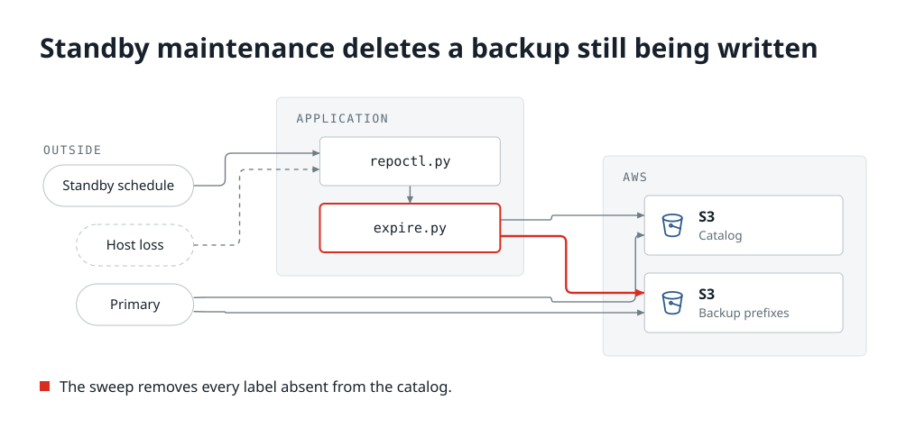

# Standby maintenance deletes a backup still being written

A primary writes full backups to S3 while a standby prunes the same repository. Maintenance treats any prefix missing from the catalog as debris, so it deletes files from a backup in progress.

## The system
Backups live in one S3 bucket, each under its own `backup/<label>/` prefix. The primary writes `backup.manifest.copy`, the data objects, then the final `backup.manifest`, and only then registers the backup in the catalog object `backup/backup.info` using a conditional write with `If-Match`. A standby runs `repoctl.py expire` to apply count retention and reclaim failed work, and a failover controller runs `repoctl.py reconcile` after losing a host. Nothing is shared but S3, and there is no lock.

## What goes wrong
- A nightly restore check found backup `20250505-141003F` invalid, with 3 of 2,568 files missing.
- The primary logged that backup as complete at 14:13.
- The standby logged `remove expired backup` for the same label at 14:11, while it was running.
- Neither job recorded an error.

## Where the issue is
In `expire.py`, `sweep` removes every label not listed in the catalog. A running backup is not listed until it finishes, so its existing objects are deleted, and the primary only adds later ones. The other steps have gaps too. `repo.save` writes the catalog unconditionally, which can erase a concurrent registration. `retain` deletes manifests before publishing. And `reconstruct` treats any leftover manifest as a backup to restore, reviving ones already retired.

The correct shape publishes a durable retirement decision with a conditional catalog write, then deletes only what that decision names. Hosts can replay it safely.

## What a correct fix must do
- Leave the newest label prefix untouched when it has a copy but no final manifest, whether its primary is running or dead.
- Remove every unfinished prefix older than the newest label (even one that still has its copy) and prefixes with neither manifest, in the same run.
- Keep complete backups, including unregistered ones, until count retention selects them.
- Make retirement final, surviving kills, overlapping hosts and delayed old workers.
- Never wait for a paused primary or change its protocol.

## How it is graded
The tests run real processes on S3 from a local AWS-compatible emulator, with a controllable primary and an HTTP relay in front of maintenance that counts its requests. They first measure a run's own requests, then repeat it with the primary publishing before each request. Other repeats kill maintenance after each request, run a competing recovery before each one, and interrupt the replacement. Afterwards they compare object ETags with what the primary wrote, and read the catalog as the restore inventory.

## Why it is hard
There is no transaction across the manifest, data and catalog. A leftover manifest may mean an unregistered backup or an interrupted deletion, and only a published decision tells them apart. The catalog must never advertise removed files, and any worker can be stopped after any request.

## Real-world basis
Modelled on a failure publicly reported against an open-source database backup tool.

## Task facts

| | |
|---|---|
| Task | `swe-cloud/if-s3-replica-expiry-deletes-running-backup` |
| Type | Issue fixing |
| AWS services | S3 |
| Language | Python |
| Runtime | Local AWS-compatible emulator. No internet access. |
| Hidden tests | 7 test functions |
| Expert estimate | 4 hours |
| Agent time limit | 1 hour |
| Resources | 2 CPUs, 3 GB memory |
