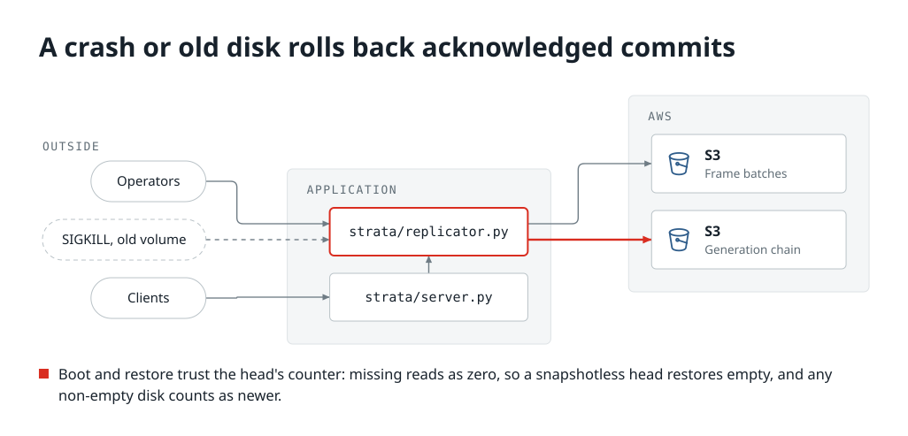

# A crash or old disk rolls back acknowledged commits

A store backs up to S3 as a chain of generations. A crash mid-snapshot, an old disk or throttling can leave restores empty or older than what was acknowledged.

## The system
`strata` backs up a single-writer record store. Each commit is answered only after its frame batch is stored in S3 under the current generation, a key prefix `NAME-GEN/`. Every boot and checkpoint starts a new generation, whose `.dep` object names its parent and whose snapshot uploads in the background. `node restore` walks `.dep` back to the nearest snapshot, then replays frames forward. So the newest generation often has no snapshot, yet holds acknowledged commits.

## What goes wrong
- A writer is killed just after a checkpoint. `node restore` prints seq 0 with no ids and exits 0, while the generation before it holds all the frames.
- A node started on a volume from an older backup comes up healthy, and a later restore is missing acknowledged commits.
- An audit finds generations with no `.dep`.
- After throttling, a writer answers every `/checkpoint` with `503` until restarted.

## Where the issue is
`compare_with_local` in `strata/replicator.py` reads a missing `.changecounter` as zero, so an empty disk matches a snapshotless head and reuses it as empty. Any non-empty local database is treated as newer, so an old disk publishes its old state as a new generation. `.dep` is written best-effort, so failures break the chain. A frame PUT answered `504` may be stored, yet the writer reuses that frame number. A failed snapshot upload wedges later checkpoints.

The right shape decides from the state the chain actually holds: restore through `.dep`, then compare.

## What a correct fix must do
- Never lose a `200` commit.
- Have `node restore` exit 3 rather than report an empty, older or forked state.
- Boot lagging disks to the bucket's newest state.
- Keep commits and checkpoints under 2 seconds during long snapshot uploads and right after a burst.
- Keep the bucket layout. Waiting for snapshots does not count.

## How it is graded
Real `node` processes reach S3 through a fault proxy. Runs SIGKILL a writer while its snapshot PUT is held, fail a `.dep` PUT once, boot copies of older disks, and throttle every PUT with `503` for 5 seconds, with one frame stored but answered `504`. Other buckets hold unlinked generations: a harmless restart that must restore, and an old-volume fork that must be refused. Tests compare restores with acknowledged commits.

## Why it is hard
Rollover cannot wait for the snapshot, so restore, boot and the old-disk check all read an unfinished head. Skipping snapshotless generations loses commits, and comparing the head's counter lets old disks through. Unlinked generations are told apart only by comparing a snapshot with the state its predecessor ended in.

## Real-world basis
Modelled on a failure publicly reported against an open-source embedded database's S3 replication component.

## Task facts

| | |
|---|---|
| Task | `swe-cloud/if-s3-replicator-rolls-back-acked-commits` |
| Type | Issue fixing |
| AWS services | S3 |
| Language | Python |
| Runtime | Local AWS-compatible emulator. No internet access. |
| Hidden tests | 34 test functions |
| Expert estimate | 4 hours |
| Agent time limit | 1 hour |
| Resources | 2 CPUs, 3 GB memory |
