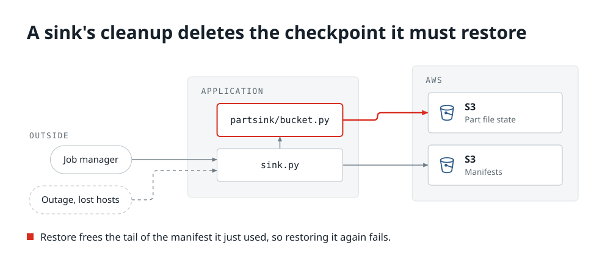

# A sink's cleanup deletes the checkpoint it must restore

An S3 multipart sink deletes the temp object of the checkpoint it just restored, so the next restart cannot restore it, yet the bucket still fills with leftovers from failed attempts.

## The system
`partsink` archives a stream into one S3 multipart upload, `jobs/<job>/out/part-0`. S3 requires 5 MiB per part except the last, so at each checkpoint the sink saves the remainder in a tail object, `_part-0_tmp_<uuid>`, and hands the job manager a snapshot naming the upload, its parts and the tail. The job manager stores it as a manifest under `chk/` and keeps the latest two, plus any savepoints. Each attempt is a new `sink.py` process, restored from a manifest.

## What goes wrong
- After a twenty-minute broker outage, restarts first failed in open, as expected.
- Once the broker returned, every restart died restoring the sink: `RecoverableStateMissing: tail object ... is gone (NoSuchKey)`.
- The job never recovered. It had to be cancelled and started fresh, losing in-flight data.
- The storage audit flagged unreferenced objects and open multipart uploads from around the restarts.

## Where the issue is
In `partsink/bucket.py`, `restore_in_progress_file` frees the tail right after recovering from it. The first restore works and the next of that manifest, after an open failure, finds nothing. `cleanup_outdated_resumables` also deletes older checkpoints' tails, though the second retained checkpoint and savepoints may still name them. Meanwhile nothing aborts orphan uploads, removes earlier attempts' tails, or runs at `END`, so a lost final notification leaks too.

The right shape frees by reachability: read every manifest under `chk/` and `savepoints/`, then delete only what none names and no undecided snapshot of this attempt needs.

## What a correct fix must do
- Keep every present manifest restorable, repeatedly: tail intact, upload open with its parts.
- Free nothing on restore or cancellation, and clean up only on `COMPLETE` and `END`.
- Leave no unreferenced tail or upload under the prefix at job end, whichever attempt made it.
- Touch nothing outside the job's prefix. Turning cleanup off or using lifecycle rules does not count.

## How it is graded
The tests run their own job manager against real `sink.py` processes in a fresh bucket, beside another job's state. One schedule restores the same checkpoint repeatedly, takes a savepoint, sends a late `COMPLETE` and leaves a gap in ids. Superseded attempts are cancelled while the next one runs, and one resumes a frozen startup. A resubmission restarts attempt numbers, and the final notification is lost. Checks audit restorability along the way, then stray objects and uploads, the neighbour, and the published file's bytes.

## Why it is hard
One `DeleteObject` both reclaims garbage and destroys restorability. A superseded attempt may still be running, so sweeps at startup or cancel can free the live attempt's unreferenced upload, and attempt-number fencing fails once a resubmission restarts at 0.

## Real-world basis
Modelled on failures publicly reported against an open-source stream processor's S3 file sink.

## Task facts

| | |
|---|---|
| Task | `swe-cloud/if-s3-sink-stuck-restoring-same-checkpoint` |
| Type | Issue fixing |
| AWS services | S3 |
| Language | Python |
| Runtime | Local AWS-compatible emulator. No internet access. |
| Hidden tests | 9 test functions |
| Expert estimate | 4 hours |
| Agent time limit | 1 hour |
| Resources | 2 CPUs, 3 GB memory |
