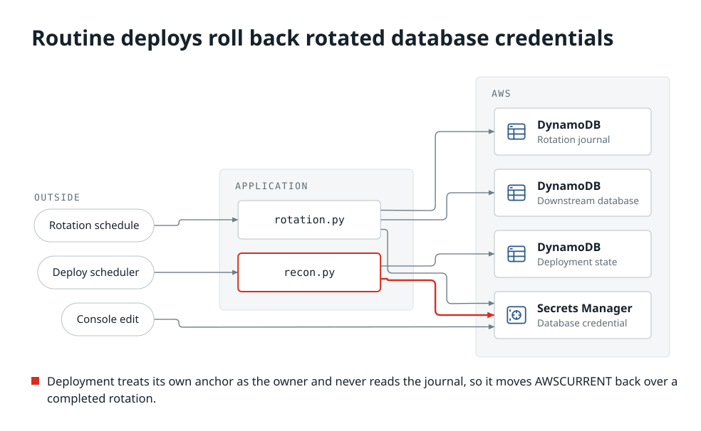

# Routine deploys roll back rotated database credentials

A deployment tool reconciles a Secrets Manager secret to a version in its DynamoDB state. After rotation, a routine deploy puts the old password back, and database logins fail.

## The system
`recon` deploys a credential: `plan` refreshes state and writes a reviewable JSON plan, and `apply` carries it out, possibly much later. It records a deployment anchor, one version id, in a DynamoDB state table. A separate rotator, `rotation.py`, publishes a new version as `AWSPENDING`, installs the password downstream, tests it, moves `AWSCURRENT` to it, then acknowledges in its own DynamoDB journal. The application reads `AWSCURRENT`. Deployment must still repair accidental console edits, which also take that label.

## What goes wrong
Routine configuration deployments cause database authentication failures on rotation-enabled installations. Turning reconciliation off is not an option, because console edits still need correcting.

## Where the issue is
`recon.py` treats its own anchor as the truth. `plan` compares that one version with `AWSCURRENT`, and `apply` moves the label back to it, without reading the journal. After a rotation, that publishes the old password. A missing anchor produces a `create` that writes the initial password as a new version. `apply` also trusts a saved plan's target, though rotation can run in between. Rebinding a resource to another secret leaves nothing that retires old plans. The correct shape decides ownership at apply time from the journal and labels, and retires reviewed plans with a durable marker in the state record.

## What a correct fix must do
- Restore the most recent completed rotation under `AWSCURRENT`, and record it as the anchor.
- Never publish an unfinished rotation, or roll back one that was published but not yet acknowledged.
- Never clone a credential into a fresh version, or write to the journal or database. Planning stays read-only.
- Treat plans reviewed before a secret replacement as retired, acknowledging them without touching AWS. A retry after a kill must finish the work.

## How it is graded
Tests create secrets and tables, run the `recon` command and script rotation steps. They apply console edits at set points, stop a rotation between publication and acknowledgement, run rotations between plan and apply, replay plans, point the anchor at a missing version, and rebind resources, including back to an earlier secret. A recording proxy kills `apply` straight after an AWS write succeeds. Tests then check labels, anchors, version sets and writes.

## Why it is hard
A pending journal row does not say whether publication happened, and labels and the journal cannot be read as one snapshot. A published but unacknowledged version can be displaced by console edits, so the evidence that it was adopted must be kept, and `AWSPREVIOUS` is only a short memory. Retirement must survive restarts, ignore ordinary rotation and tell an unfinished replacement from a finished one.

## Real-world basis
Modelled on a failure publicly reported against an open-source infrastructure-as-code tool's Secrets Manager version resource.

## Task facts

| | |
|---|---|
| Task | `swe-cloud/if-secretsmanager-dynamodb-deploy-breaks-rotated-secret` |
| Type | Issue fixing |
| AWS services | DynamoDB, Secrets Manager |
| Language | Python |
| Runtime | Local AWS-compatible emulator. No internet access. |
| Hidden tests | 13 test functions |
| Expert estimate | 4 hours |
| Agent time limit | 1 hour |
| Resources | 2 CPUs, 3 GB memory |
