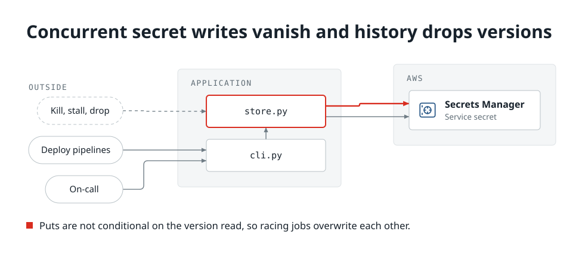

# Concurrent secret writes vanish and history drops versions

A secrets tool keeping each service in one Secrets Manager secret loses acknowledged writes to races, drops history as labels move, and eventually hits the 20 label quota.

## The system
Deploy pipelines set service configuration through a small Python CLI, and on-call uses `history` and `read --version` to roll back. All keys of a service sit in one secret as a JSON object, with a metadata field recording each key's version number. History replays the secret's versions, so a value stays visible only while its version keeps a staging label. Writes are separate jobs with no shared lock.

## What goes wrong
- Writing `key1`, `key1`, then `key2` makes version 1 of `key1` vanish from history.
- Jobs exited 0, yet their values were neither current nor in history, when another pipeline wrote the same key.
- Every write to `payments/db_password` now fails with `LimitExceededException`.

## Where the issue is
In `store.py`, `write()` reads the secret, edits it locally, then calls `PutSecretValue` with `AWSCURRENT` and a numbered label taken from that key's own version. Nothing checks that the current version is still the one read, so two jobs overwrite each other, and `PutSecretValue` moves every label it names unconditionally. Per-key numbers mean a second key's version 1 takes label 1 from whichever version held it. The `CreateSecret` version gets no history label, so it drops out once `AWSPREVIOUS` moves on. Nothing recycles labels.

The right shape makes each put conditional on the version read, say with a `ClientRequestToken` derived from it, and reuses the oldest version's label once full.

## What a correct fix must do
- Keep every write that exited 0 current until replaced, and in history for at least 15 further writes.
- Give each version one value, with finishing order matching version order.
- Survive kills, stalls and dropped connections. A retried request counts as one write.
- Let concurrent writers all succeed without locks.
- Work on existing full secrets, recycling by age rather than label number.
- Keep the command line and storage format, using only the six permitted API actions.

## How it is graded
The tests route the CLI through a proxy that enforces the label quota, which the local emulator does not. They run sequential writes, replay writes on a service at the quota, and sweep each mutating call in turn: parking a writer while others proceed, killing another, and dropping a third's answer after the request applies. They then compare the secret's current values and history with the writes that exited 0.

## Why it is hard
The label that stops a version being deleted is also what the put moves, so a stale writer can wreck history. The token must be deterministic, or a dropped connection's retry cannot recognise itself. Label recycling must handle old secrets, where label numbers do not follow write order.

## Real-world basis
Modelled on a failure publicly reported against an open-source secrets management CLI.

## Task facts

| | |
|---|---|
| Task | `swe-cloud/if-secretsmanager-secret-history-lost-concurrent-writers` |
| Type | Issue fixing |
| AWS services | Secrets Manager |
| Language | Python |
| Runtime | Local AWS-compatible emulator. No internet access. |
| Hidden tests | 8 test functions |
| Expert estimate | 5 hours |
| Agent time limit | 1 hour |
| Resources | 2 CPUs, 3 GB memory |
