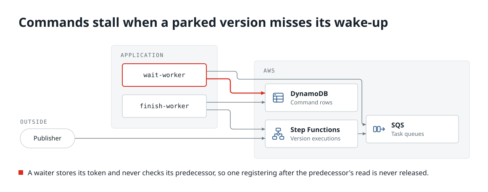

# Commands stall when a parked version misses its wake-up

A command service parks each version in Step Functions until its predecessor releases it, but a late or stale read loses that release, so projections stop while executions stay RUNNING.

## The system
Each accepted `(entity, version)` gets a row in the DynamoDB `commands` table and its own Standard execution of `command-chain`. Version 1 goes straight to sync. Later versions park in `wait_prev_command`, a `waitForTaskToken` step that puts a callback token on the `wait-prev` SQS queue, then sync and finish. `worker.py` consumes those messages: wait workers store the token on the row, and finish workers release the next version's token with `SendTaskSuccess`. Sync effects must apply in version order, exactly once.

## What goes wrong
- Some customer projections stop advancing while their executions remain `RUNNING`.
- Retrying publication has made the backlog longer.
- Draining the backlog takes manual callback completion.

## Where the issue is
`Worker.finish` in `worker.py` writes `finish:STARTED`, then reads the next row once and pushes a callback if a token is there. `Worker.wait` only stores its token. If the successor registers after that read, nothing ever releases it. The read is also eventually consistent, so a just-stored token can be missed.

Duplicates add a second problem. Redelivery can start another execution for one version, and `wait` overwrites the row's token unconditionally, so which execution owns the version is undecided, and a naive fix releases both.

The right shape is a handshake. The first token wins through a conditional write, then the waiter does its own consistent read of the predecessor and releases itself if `finish:STARTED` has committed. Finish still pushes.

## What a correct fix must do
- Release a ready version within eight seconds, even when another worker's status write takes 15.
- Apply each version's sync once, in order, with duplicate executions parked or retired as `duplicate`.
- Keep successors parked when a predecessor fails before finish, and never release on `sync_data:FINISHED`.
- Treat `TaskDoesNotExist` and `TaskTimedOut` as ordinary races.
- Keep the wait handler short, with no resident poller or scanner.

## How it is graded
Tests run real workflows and the sink, with workers reaching AWS through a gateway that can hold status writes, reads and callbacks, and throttle reads. Scenarios publish versions out of order, delay publication, reject a predecessor's sync, redeliver executions, race push against pull, burst publications, and close callbacks early. They check execution histories, release deadlines, effect order and read counts.

## Why it is hard
Either side alone leaves a gap, and with both sides the two callbacks collide, so a losing `SendTaskSuccess` must not fail finish. Status is overwritten by other steps, so a pull check must accept `finish:FINISHED` too. Reads are capped per version, and a read failure in finish must not turn into a failed callback.

## Real-world basis
Modelled on a change publicly proposed to an open-source serverless command framework, adding a task token handshake for waiting on a previous command.

## Task facts

| | |
|---|---|
| Task | `swe-cloud/if-sfn-dynamodb-command-projection-stall` |
| Type | Issue fixing |
| AWS services | Step Functions, SQS, DynamoDB |
| Language | Python |
| Runtime | Local AWS-compatible emulator. No internet access. |
| Hidden tests | 8 test functions |
| Expert estimate | 4 hours |
| Agent time limit | 1 hour |
| Resources | 2 CPUs, 3 GB memory |
