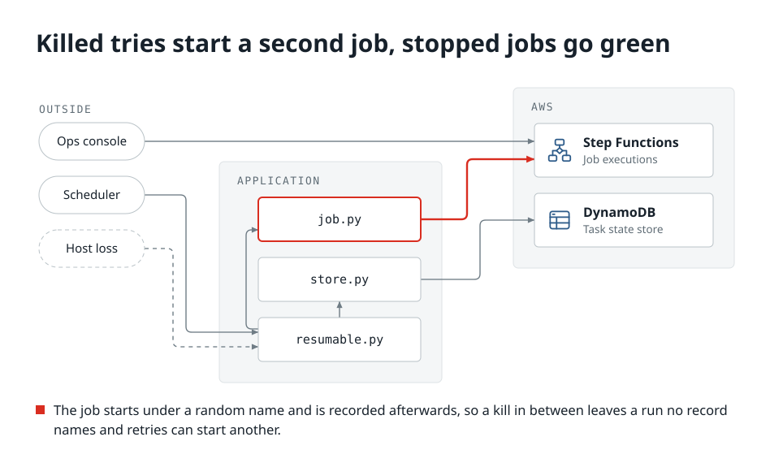

# Killed tries start a second job, stopped jobs go green

A task worker starts a Step Functions job before recording it in DynamoDB. A kill in between runs the load twice, and a stop from the console counts as success.

## The system
`durable_task` runs one try of a task instance, as a fresh process that may land on any host. Its work is a long warehouse load: a Standard Step Functions execution. A DynamoDB item per task instance, in `task_state_store`, holds `execution_arn`, so a later try can reconnect, return if it succeeded, or start again. A separate reconciler stops only what that item names once a task has failed for good.

## What goes wrong
- A host was OOM-killed while a try was starting its job. The next try started another execution while the first still ran, and both loaded the same partition.
- Ops stopped a hung load from the console. The polling try reported success, the task went green, and downstream published a partition that was never loaded.

## Where the issue is
`execute()` in `resumable.py` calls `StartExecution` with a random name and writes `execution_arn` only afterwards. A kill between the two leaves a running execution no record names. The fallback search runs only with no record at all, and trusts an immediate listing, while `DescribeExecution` and `ListExecutions` are eventually consistent on AWS. Separately, `job.py` lists `ABORTED` in `SUCCESS_STATUSES`.

The right shape writes the ARN ahead of the start. Standard `StartExecution` with the same name and input returns the running execution, so a retry can safely reissue it.

## What a correct fix must do
- Never have two live executions for one task instance, whatever instant a try dies.
- Fail a try whose execution stops, fails or times out, and run the job under a new name next time.
- Bring a clear straight back green once the job has succeeded.
- Only pick up this task instance's own executions.
- Carry on from records and executions the deployed version left behind.

## How it is graded
Each try is its own process behind its own HTTP proxy to a local AWS-compatible emulator. The proxy imitates production: it denies calls outside the worker's policy, applies the real naming rules, and hides new executions from reads for a while. It kills tries at exact request boundaries. Other task instances start from states the old version would leave, such as an unrecorded running execution. The tests sample running executions and check exit statuses, the record, and the reconciler's stop.

## Why it is hard
Writing ahead makes "recorded but not found" ambiguous, so the retry reissues the same name instead of picking a new one. Old records need the opposite rule: nothing can be reissued, so the try must wait out listing lag, then start. Failing closed wedges the task, and starting immediately duplicates the load.

## Real-world basis
Modelled on a change publicly proposed to an open-source workflow orchestrator's resumable job support.

## Task facts

| | |
|---|---|
| Task | `swe-cloud/if-sfn-dynamodb-durable-task-rerun-after-kill` |
| Type | Issue fixing |
| AWS services | Step Functions, DynamoDB |
| Language | Python |
| Runtime | Local AWS-compatible emulator. No internet access. |
| Hidden tests | 13 test functions |
| Expert estimate | 4 hours |
| Agent time limit | 1 hour |
| Resources | 2 CPUs, 3 GB memory |
